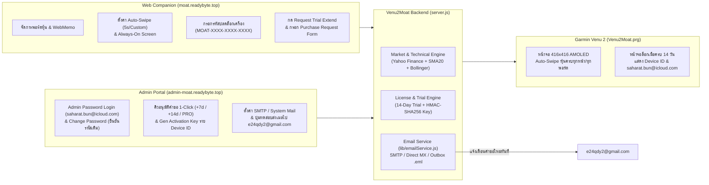

# Venu2Moat — Multi-Device Garmin Portfolio (2024–2026), Auto-Swipe, Security VA Hardened & Licensing Platform

ระบบติดตามพอร์ตหุ้น (US / Thai SET `.BK` / Crypto), แจ้งเตือนราคาเป้าหมาย (Target/Stop Alert), กราฟ Sparkline + SMA-20 + Bollinger Bands, และบันทึกช่วยจำ **WebMemo** ที่ออกแบบด้วยสถาปัตยกรรม **Responsive Round-Screen Layout (`260×260` ถึง `454×454` AMOLED & Solar MIP)** รองรับนาฬิกา **Garmin รุ่นยอดนิยมปี 2024–2026 รวม 20 รุ่น** พร้อมระบบ **Auto-Swipe หน้าจออัตโนมัติ**, **โหมด Always-On Screen**, **ระบบทดลองใช้ฟรี 14 วัน (14-Day Trial)**, **ฟอร์มขอต่ออายุ Trial / สั่งซื้อคีย์ถาวร (Purchase Request Form)**, **บริการส่งอีเมลแจ้งเตือน SMTP / System Mail ไปยัง `e24qdy2@gmail.com`**, และ **หน้า Admin ออกคีย์ปลดล็อกรายเครื่อง (`Device ID`) ที่ผ่านการทำ Security / Vulnerability Assessment (VA) Hardening ครบสมบูรณ์**

---

## ⌚ รุ่นนาฬิกา Garmin ที่รองรับ (20 Popular Models 2024–2026)

| ตระกูล (Series) | รุ่นที่รองรับ (Model Name) | Connect IQ ID | ความละเอียดหน้าจอ | ประเภทจอและการควบคุม |
| :--- | :--- | :--- | :--- | :--- |
| **Venu Series** | **Garmin Venu 3** | `venu3` | `454×454` | AMOLED · Touch + 3 Buttons |
| **Venu Series** | **Garmin Venu 3S** | `venu3s` | `390×390` | AMOLED · Touch + 3 Buttons |
| **Venu Series** | **Garmin Venu 2** | `venu2` | `416×416` | AMOLED · Touch + 2 Buttons |
| **Venu Series** | **Garmin Venu 2 Plus** | `venu2plus` | `416×416` | AMOLED · Touch + 3 Buttons |
| **Venu Series** | **Garmin Venu 2S** | `venu2s` | `360×360` | AMOLED · Touch + 2 Buttons |
| **vívoactive Series** | **Garmin vívoactive 5 / 6** | `vivoactive5` | `390×390` | AMOLED · Touch + 2 Buttons |
| **Forerunner Series** | **Garmin Forerunner 165** | `fr165` | `390×390` | AMOLED · Touch + 5 Buttons |
| **Forerunner Series** | **Garmin Forerunner 165 Music** | `fr165m` | `390×390` | AMOLED · Touch + 5 Buttons |
| **Forerunner Series** | **Garmin Forerunner 265** | `fr265` | `416×416` | AMOLED · Touch + 5 Buttons |
| **Forerunner Series** | **Garmin Forerunner 265S** | `fr265s` | `360×360` | AMOLED · Touch + 5 Buttons |
| **Forerunner Series** | **Garmin Forerunner 965** | `fr965` | `454×454` | AMOLED · Touch + 5 Buttons |
| **fēnix 8 Series** | **Garmin fēnix 8 (43mm AMOLED)** | `fenix843mm` | `416×416` | AMOLED · Touch + 5 Buttons |
| **fēnix 8 Series** | **Garmin fēnix 8 (47mm AMOLED)** | `fenix847mm` | `454×454` | AMOLED · Touch + 5 Buttons |
| **fēnix 8 Series** | **Garmin fēnix 8 (51mm AMOLED)** | `fenix851mm` | `454×454` | AMOLED · Touch + 5 Buttons |
| **fēnix 8 Solar** | **Garmin fēnix 8 Solar (47mm MIP)** | `fenix8solar47mm` | `260×260` | Solar MIP · Touch + 5 Buttons |
| **Enduro Series** | **Garmin Enduro 3 (51mm Solar MIP)** | `enduro3` | `280×280` | Solar MIP · Touch + 5 Buttons |
| **epix Pro (Gen 2)** | **Garmin epix Pro (Gen 2) 42mm** | `epix2pro42mm` | `390×390` | AMOLED · Touch + 5 Buttons |
| **epix Pro (Gen 2)** | **Garmin epix Pro (Gen 2) 47mm** | `epix2pro47mm` | `416×416` | AMOLED · Touch + 5 Buttons |
| **epix Pro (Gen 2)** | **Garmin epix Pro (Gen 2) 51mm** | `epix2pro51mm` | `454×454` | AMOLED · Touch + 5 Buttons |
| **Approach Series** | **Garmin Approach S70 (42mm / 47mm)** | `approachs7042mm`, `approachs7047mm` | `390×390` / `454×454` | AMOLED · Touch + 3 Buttons |

---

## 🛡️ Security & Vulnerability Assessment (VA) Hardening Summary

- **Zero Client-Side Credential Leaks (`C-01`):** ลบ Hint รหัสผ่านเริ่มต้นออกจาก `public/admin.html`, `public/admin.js`, และเอกสารทั้งหมด 100% (ตรวจสอบผ่าน View Page Source / DevTools จะไม่พบรหัสผ่านใดๆ)
- **Authentication Bypass Eliminated (`C-02`):** ปิดกั้น Legacy OTP Endpoint (`/api/admin/auth/request-otp` คืนค่า `HTTP 403`) และป้องกันการปลอมแปลง Header `cf-access-authenticated-user-email` หากไม่มี `cf-access-jwt-assertion`
- **Secret Externalization (`C-03` & `C-04`):** แยก `LICENSE_HMAC_SECRET` และ `ADMIN_INITIAL_PASSWORD` ไปไว้ในไฟล์ `.env` (ซึ่งอยู่ใน `.gitignore`) และถอนไฟล์ `data/licenses.json` กับ `data/mail-outbox/*.eml` ออกจาก Git Tracking
- **Public API Data Redaction (`H-01`):** ซ่อนค่า `issuedKey` ใน Public API (`/api/portfolio` และ `/api/device/status`) หากเครื่องนั้นยังอยู่ในสถานะ `TRIAL` หรือ `EXPIRED`
- **Brute-Force Lockout & IP Rate Limiting (`H-02`):** ล็อก IP ทันที 15 นาที (`HTTP 429`) เมื่อล็อกอิน Admin ผิดครบ 5 ครั้ง และจำกัดความถี่การยิง `/api/device/activate` กับ `/api/license/request`
- **Security Headers & Cookie Hardening (`M-01`..`M-03`):** บังคับใช้ `Content-Security-Policy (CSP)`, `Strict-Transport-Security (HSTS)`, `X-Frame-Options: DENY`, `X-Content-Type-Options: nosniff`, `Cache-Control: no-store`, Restricted CORS และคุกกี้ `__moat_admin_session` แบบ `HttpOnly; SameSite=Strict`

---

## 🌐 Live Endpoints บน Cloudflare (`readybyte.top`)

| บริการ | URL เข้าใช้งาน | รายละเอียด |
| :--- | :--- | :--- |
| **Web Companion & 416×416 Simulator** | **[`https://moat.readybyte.top`](https://moat.readybyte.top)** | จัดการพอร์ตหุ้น, จดบันทึก WebMemo, ตั้งค่า Auto-Swipe (`5s`/Custom) & Always-On Display, ใส่ Activation Key, กด **Request Trial Key Extend** และกรอก **Purchase Request Form** |
| **Admin Licensing Portal (Subdomain)** | **[`https://admin-moat.readybyte.top`](https://admin-moat.readybyte.top)** | หน้าบริหารจัดการสำหรับเจ้าของระบบ (**`saharat.bun@icloud.com`**) เข้าสู่ระบบด้วย **Admin Password** (และเปลี่ยนรหัสผ่านใหม่พร้อมยืนยันรหัสเดิมได้หลังล็อกอิน) เพื่ออนุมัติคำขอจากลูกค้า, ตั้งค่า SMTP ส่งเมลไปที่ **`e24qdy2@gmail.com`**, และสร้าง Activation Key ราย `Device ID` |
| **Garmin Venu 2 Watch JSON API** | **[`https://moat.readybyte.top/api/watch?key=VENU2-88`](https://moat.readybyte.top/api/watch?key=VENU2-88)** | Compact JSON Endpoint (`<4KB`) สำหรับแอปนาฬิกา Garmin Venu 2 |

---

## 📚 สารบัญเอกสารคู่มือและสถาปัตยกรรม (Detailed Documentation)

เอกสารทั้งหมดจัดทำอย่างละเอียดพร้อมแผนภาพ **App Design**, **App Flow**, และ **Logic Flow**:

1. 📖 **[คู่มือการใช้งานฉบับสมบูรณ์ (User, Watch & Admin Manual)](./docs/01-USER-AND-ADMIN-MANUAL.md)**
   - วิธีติดตั้งไฟล์ `Venu2Moat.prg` ลงนาฬิกา Garmin Venu 2 ผ่านสาย USB MTP
   - วิธีใช้งานปุ่มกดและการปัดหน้าจอบนนาฬิกา
   - วิธีตั้งค่า **Auto-Swipe (ค่าเริ่มต้น 5 วินาที / กำหนดเอง 2–120 วินาที)** และ **Always-On Screen** ผ่านเว็บ
   - การใช้งานระบบ **Trial 14 วัน**, การกด **Request Trial Key Extend**, การกรอก **Purchase Request Form**, การติดต่อเจ้าของระบบ **`saharat.bun@icloud.com`**, และการอนุมัติคำขอ/ตั้งค่า SMTP ส่งเมลเข้า **`e24qdy2@gmail.com`** ในหน้า **Admin Portal**
2. 🎨 **[การออกแบบแอปและพิกัดหน้าจอ 416×416 AMOLED (App Design & UI Spec)](./docs/02-APP-DESIGN-AND-UI-SPEC.md)**
   - ข้อจำกัดฮาร์ดแวร์ Garmin Venu 2 และการประหยัดพลังงานด้วย True Void Black (`#000000`)
   - ผังพิกัดหน้าจอ 416×416 พิกเซลทั้ง 3 หน้าจอหลัก (Portfolio View, Symbol Detail + Sparkline + WebMemo View, และ 14-Day Trial Expired Lock Screen ที่แสดง `saharat.bun@icloud.com`)
   - แผนภาพคลาส Monkey C (`Class Diagram`)
3. 🔄 **[ลำดับการทำงานและตรรกะของระบบ (App Flow & Logic Flow)](./docs/03-APP-FLOW-AND-LOGIC-FLOW.md)**
   - แผนภาพสถาปัตยกรรม End-to-End (`Cloudflare Tunnel` ⇄ `Node.js Server` ⇄ `Garmin Venu 2` ⇄ `SMTP/System Mail -> e24qdy2@gmail.com`)
   - Sequence Diagram การเปิดแอปและการซิงค์ข้อมูลแบบ Offline-First
   - Flowchart ตรรกะการทำงานของ **1-Second Runtime Timer** สำหรับ **Auto-Swipe Pagination** และ **Always-On Backlight**
   - State Machine & อัลกอริทึม **HMAC-SHA256 Per-Device Activation Key** (`MOAT-XXXX-XXXX-XXXX`)
   - Sequence Diagram การส่งคำขอ **Trial Extend / Purchase Request Form**, การส่งเมลแจ้งเตือนไปยัง **`e24qdy2@gmail.com`**, และการกดอนุมัติใน 1 คลิก
4. 🛠️ **[เอกสารอ้างอิง API, โครงสร้างข้อมูล และ SDLC (API & SDLC Reference)](./docs/04-API-AND-SDLC-REFERENCE.md)**
   - แผนภาพฐานข้อมูล (`ER Diagram`) ของ `portfolios.json`, `licenses.json`, และ `data/mail-outbox/*.eml`
   - รายละเอียด REST API ทุก Endpoint พร้อมตัวอย่าง JSON
   - คู่มือการรันชุดทดสอบอัตโนมัติ 8 ชุด (`tests/sdlc.test.js`)

---

## 🏗️ แผนภาพภาพรวมการทำงานของระบบ (High-Level System Flow)



---

## 📂 โครงสร้างไฟล์ในโปรเจกต์ (Project Structure)

```text
garmin-venu2-moat/
├── README.md                          # หน้าหลักสรุปภาพรวมและสารบัญเอกสาร
├── docs/                              # คู่มือการใช้งานและเอกสารการออกแบบระบบอย่างละเอียด
│   ├── 01-USER-AND-ADMIN-MANUAL.md    # คู่มือผู้ใช้, นาฬิกา Garmin Venu 2, ฟอร์มสั่งซื้อ และหน้า Admin
│   ├── 02-APP-DESIGN-AND-UI-SPEC.md   # พิกัดหน้าจอ 416x416 AMOLED & Class Diagram
│   ├── 03-APP-FLOW-AND-LOGIC-FLOW.md  # Sequence Diagrams, State Machines & Logic Flows
│   └── 04-API-AND-SDLC-REFERENCE.md   # ER Diagram, REST API Docs & SDLC Test Guide (8 Suites)
├── server.js                          # เซิร์ฟเวอร์หลัก (Web API + Watch API + Admin Subdomain Router)
├── lib/
│   ├── licenseManager.js              # เอ็นจิ้นจัดการ Trial 14 วัน, คิวคำขอลูกค้า, HMAC Key & Admin Password
│   └── emailService.js                # เอ็นจิ้นส่งอีเมลแจ้งเตือนไปที่ e24qdy2@gmail.com (SMTP TLS + Direct MX + Outbox)
├── public/
│   ├── index.html                     # หน้าเว็บหลัก Web Companion + 416x416 Simulator + Modal ฟอร์มคำขอ
│   ├── app.js                         # ลอจิกหน้าเว็บหลัก, Auto-Swipe Simulator, Settings Sync & Request Form
│   ├── admin.html                     # หน้าเว็บ Admin Portal (https://admin-moat.readybyte.top)
│   ├── admin.js                       # ลอจิกหน้า Admin, อนุมัติคำขอ 1 คลิก, ตั้งค่า SMTP & Key Generator
│   └── styles.css                     # สไตล์เสริมสำหรับหน้าเว็บ
├── garmin-venu2-app/                  # ซอร์สโค้ดแอปนาฬิกา Garmin Connect IQ (Monkey C)
│   ├── manifest.xml                   # กำหนดค่าแอปสำหรับ Garmin Venu 2 (venu2)
│   ├── monkey.jungle                  # ไฟล์ตั้งค่าการคอมไพล์ Connect IQ
│   ├── resources/                     # ไอคอน, ฟอนต์, Strings และ Settings Properties XML
│   └── source/
│       ├── Venu2MoatApp.mc            # จุดเริ่มต้นแอปและการควบคุม Runtime Timer
│       ├── PortfolioStore.mc          # จัดการข้อมูล, Auto-Swipe, Always-On Backlight & License State
│       ├── Venu2MoatView.mc           # วาดหน้าจอหลัก 416x416 และหน้าจอล็อก Trial 14d Expired
│       ├── Venu2MoatDelegate.mc       # รับอินพุตปุ่มกดและการปัด/แตะหน้าจอ
│       ├── SymbolDetailView.mc        # วาดกราฟ Sparkline, SMA-20, Bollinger และ WebMemo
│       ├── SymbolDetailDelegate.mc    # รับอินพุตในหน้ารายละเอียดหุ้น
│       └── Venu2MoatGlanceView.mc     # วาด Widget Glance บนหน้ารวมของนาฬิกา
├── dist/
│   └── Venu2Moat.prg                  # ไฟล์ไบนารีที่คอมไพล์แล้วสำหรับติดตั้งลง Garmin Venu 2
├── tests/
│   └── sdlc.test.js                   # ชุดทดสอบอัตโนมัติ End-to-End ครบ 8 ส่วนตามมาตรฐาน SDLC
├── build-and-sideload.ps1             # สคริปต์คอมไพล์ .prg + Sideload ผ่าน MTP USB + Auto-Sync GitHub
├── start-cloudflare-domain.ps1        # สคริปต์รัน Cloudflare Tunnel สำหรับ moat & admin-moat.readybyte.top
└── sync-github.ps1                    # สคริปต์ Commit & Push การเปลี่ยนแปลงขึ้น GitHub อัตโนมัติ
```

---

## 🚀 คำสั่งใช้งานด่วน (Quick Commands)

```powershell
# 1. รันเซิร์ฟเวอร์ Web Companion + Watch API + Admin Portal (พอร์ต 3880)
npm start

# 2. รันชุดทดสอบอัตโนมัติ SDLC ทั้ง 8 ชุด (100% Green)
npm test

# 3. คอมไพล์แอป Venu2Moat.prg และส่งเข้านาฬิกาผ่านสาย USB MTP (พร้อม Sync ขึ้น GitHub)
npm run build:watch

# 4. อัปเดตซอร์สโค้ดล่าสุดขึ้น GitHub Repository อัตโนมัติ
npm run git:sync
```
