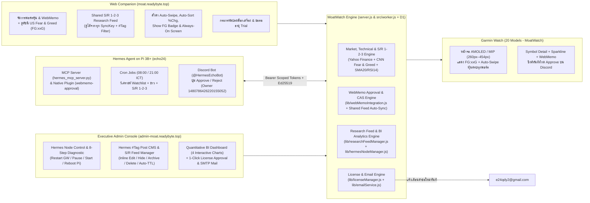

# MoatWatch — Multi-Device Garmin Portfolio Companion (2024–2026), Hermes AI Quant Analyst (MCP + Discord Approval), Shared Support/Resistance 1–2–3 Feed & Executive BI Admin Platform

ระบบติดตามพอร์ตหุ้นหลายพอร์ต (US / Thai SET `.BK` / Crypto), **เชื่อมโยงกับ Hermes Agent บน Raspberry Pi 3B+ (`echo24`) ผ่านโปรโตคอล MCP (Model Context Protocol) และระบบอนุมัติ WebMemo ผ่านปุ่มกด Discord**, **กระดานวิเคราะห์แนวรับ/แนวต้าน 3 ระดับ (Support/Resistance 1–2–3: ระยะสั้น `S1/R1` · ระยะกลาง `S2/R2` · ระยะยาว `S3/R3`) ที่แชร์ร่วมกันทุก SyncKey**, **ดัชนีจิตวิทยาตลาดหุ้นสหรัฐฯ รายวัน (`FG:xxG` / `FG:xxEF`)**, อินดิเคเตอร์ครบชุด (**SMA-20 + SMA%**, **RSI-14**, **Day High/Low**, **วันประกาศงบ `e-dd/mm/yy`**, **กราฟ 14-Day Sparkline + Bollinger Bands**), และบันทึกช่วยจำ **WebMemo** บนสถาปัตยกรรม **Responsive Round-Screen Layout (`260×260` ถึง `454×454` AMOLED & Solar MIP)** รองรับนาฬิกา **Garmin รุ่นยอดนิยมปี 2024–2026 รวม 20 รุ่น** พร้อม **หน้า Admin Console โฉมใหม่ (`admin-moat.readybyte.top`) ที่รวมศูนย์ควบคุม Hermes Gateway & Raspberry Pi ระยะไกล, ระบบ CMS จัดการโพสต์ `#Tags` + Auto-Archive, และกระดาน Quantitative BI Dashboard**

---

## ✨ ฟีเจอร์ไฮไลต์ล่าสุด (Latest Release Highlights)

- 🤖 **Hermes AI Quant Analyst (`echo24`) ↔ MoatWatch Scoped MCP & Discord WebMemo Approval:**
  - เชื่อมต่อ **Hermes Agent** บน Raspberry Pi 3B+ (`echo24`) เข้ากับฐานข้อมูล **Cloudflare Worker + D1 (`venu2-moat-db`)** ด้วยสิทธิ์แบบ **Least-Privilege (`SCOPED_MEMO_ONLY`)** — ห้ามแก้ไขจำนวนหุ้น (`shares`), ต้นทุน (`avgCost`), เป้าหมายราคา (`targetPrice`/`stopPrice`), หรือส่งคำสั่งซื้อขายโดยเด็ดขาด
  - **ระบบอนุมัติผ่านปุ่มกด Discord (Owner-Only Interactive Approval):** เมื่อ Hermes วิเคราะห์หุ้นและเสนอร่าง WebMemo ($\le 140$ ตัวอักษร) ระบบจะส่งการ์ดปุ่ม **`อนุมัติขึ้นเว็บ (Approve)`** และ **`ปฏิเสธ (Reject)`** เข้าห้อง Discord พร้อมตรวจสิทธิ์เจ้าของ (`WEBMEMO_ALLOWED_DISCORD_USER_IDS`), ป้องกันการกดซ้ำ (Replay Protection), อายุร่าง 24 ชั่วโมง, และระบบ **Compare-And-Swap (`memoRevision`) + Readback Verification**
  - **ซิงก์ 2 ทางอัตโนมัติหลังกด Approve:** ทันทีที่เจ้าของกดอนุมัติใน Discord ระบบจะอัปเดตทั้ง **WebMemo ในพอร์ตของเจ้าของ (`V2-***81`)** และอัปเดต **การ์ดวิเคราะห์แนวรับ/ต้าน S/R 1–2–3 กลาง (`#DiscordApproved`)** บนหน้าเว็บให้ทุก SyncKey เห็นพร้อมกัน
- 📈 **Shared Support/Resistance Level 1–2–3 (`S1/S2/S3` & `R1/R2/R3`) Research Feed (ดูได้ทุก SyncKey):**
  - แสดงการ์ดวิเคราะห์แนวรับ 3 ระดับ (**`S1` ระยะสั้น · `S2` ระยะกลาง · `S3` ระยะยาว**) และแนวต้าน 3 ระดับ (**`R1` ระยะสั้น · `R2` ระยะกลาง · `R3` ระยะยาว**) พร้อมแถบตำแหน่งราคาปัจจุบัน (`Price Position Gauge`), อัตราผลตอบแทนต่อความเสี่ยง (`Risk/Reward Ratio`), และตาราง **Watchlist Multi-Horizon S/R Matrix** ที่แชร์ให้ผู้ใช้ทุก `SyncKey` ติดตามบทวิเคราะห์จาก Hermes ร่วมกันได้
- 🎛️ **Executive Admin Console โฉมใหม่ (`https://admin-moat.readybyte.top`):**
  - **Hermes Live Telemetry & Remote Control Center:** ตรวจสอบสถานะการเชื่อมต่อของ `echo24` แบบเรียลไทม์ (สถานะ `ONLINE`/`OFFLINE`, `gatewayPid`, อุณหภูมิ CPU, RAM, Load Average, Uptime) พร้อม **5 ปุ่มคำสั่งควบคุมระยะไกล**:
    1. `Restart GW Hermes` (`RESTART_GW`) — สั่งรีสตาร์ท `hermes-gateway.service`
    2. `Pause / Stop Hermes` (`PAUSE_STOP_HERMES`) — พักหรือหยุดการทำงานของ Hermes Gateway ชั่วคราวโดยที่ตัวรับคำสั่ง (`moat-hermes-node.service`) ยังออนไลน์อยู่
    3. `Start Hermes Service` (`START_HERMES`) — สั่งเปิดบริการ `hermes-gateway.service` กลับมาทำงานต่อได้ทันที
    4. `Reboot Pi (echo24)` (`REBOOT_PI`) — สั่งรีบูตเครื่อง Raspberry Pi ระยะไกล
    5. `Test All Hermes & API Functions` (`TEST_ALL_FUNCTIONS`) — รันชุดตรวจสอบ End-to-End ครบ 8 ขั้นตอนฝั่ง Server + 6 ขั้นตอนฝั่ง Raspberry Pi (`echo24`)
  - **Hermes `#Tag` Research CMS & Auto-Archive Engine:** สร้าง/แก้ไข/ปักหมุด (`Pin`)/ซ่อน (`Archive`)/กู้คืน (`Restore`)/ลบการ์ดบทวิเคราะห์ กรองตาม `#tag` และตั้งค่า **Auto-Archive Policy** เพื่อซ่อนการ์ดเก่าอัตโนมัติตามอายุวัน (เช่น 21 วัน) ไม่ให้หน้าเว็บรกรุงรัง
  - **Quantitative BI & Virtualized Dashboard:** กราฟแท่งซ้อน (Stacked Bar Charts 4 มุมมอง: User Portfolio Stack, S/R Quantitative Stack, Topic `#Tag` Stack, WebMemo Coverage Stack) และกราฟโดนัท (Donut Charts 3 มุมมอง) สรุปภาพรวมเชิงปริมาณครบทุกมิติ
- 📊 **Daily US Market Fear & Greed Index (`FG:xxG` / `FG:xxEF`):**
  - ดึงค่าดัชนี **CNN US Stock Market Fear & Greed Index (0–100)** รายวันอัตโนมัติ แสดงทั้งบนหน้าเว็บและบนแถบสถานะบนสุดของนาฬิกา Garmin (`14:30 · FG:64G · 5s · PRO`)
- ⌚ **รองรับนาฬิกา Garmin 20 รุ่น (2024–2026 Lineup) & Connect IQ Store Ready (`MoatWatch.iq`):**
  - รองรับหน้าจอกลม `260×260` ถึง `454×454` (AMOLED & Solar MIP) พร้อมระบบ **Auto-Swipe หน้าจออัตโนมัติ**, **Auto-Sort เรียงหุ้นตาม `% Change`**, และ **Multi-User Isolation**

---

## 🔌 ความสามารถของ MoatWatch MCP (`moatwatch-webmemo`) & Hermes Plugin (`webmemo-approval`)

ไฟล์หลัก: [`integrations/hermes_pi/moat_mcp_server.py`](./integrations/hermes_pi/moat_mcp_server.py), [`integrations/hermes_pi/plugin/__init__.py`](./integrations/hermes_pi/plugin/__init__.py), และ [`integrations/hermes_pi/moat_node_agent.py`](./integrations/hermes_pi/moat_node_agent.py)

| ลำดับ | ชื่อ Tool (MCP & Plugin) | ความสามารถและการทำงาน | สิทธิ์การเข้าถึง |
| :--- | :--- | :--- | :--- |
| **1** | `moat_get_account_portfolio` | อ่านพอร์ตโฟลิโอ (`us-moat`), หุ้นที่ถือครอง และรายการ **Watchlist ทั้งหมด** ของบัญชีเจ้าของ (`V2-***81`) เพื่อใช้เป็นข้อมูลตั้งต้นในการวิเคราะห์รายวัน (กรองตาม `portfolioId` หรือ `symbol` ได้) | อ่านอย่างเดียว (ซ่อน SyncKey จริง) |
| **2** | `moat_get_holding_memo` | อ่านข้อความ `memo` ปัจจุบันบนหน้าเว็บ, เลขเวอร์ชัน (`memoRevision`), `contentHash` และเช็คว่ามีร่างค้างอนุมัติอยู่หรือไม่ของหุ้นรายตัว | อ่านอย่างเดียว |
| **3** | `moat_propose_webmemo_draft` | สร้างร่าง **WebMemo** ใหม่ ($\le 140$ ตัวอักษร) พร้อมสรุปเหตุผล/สัญญาณ (`analysisSummary`) ลงฐานข้อมูล D1 และ **ส่งการ์ดปุ่มกด `Approve` / `Reject` เข้าห้อง Discord อัตโนมัติ** (ยังไม่เขียนลงเว็บจริงจนกว่าเจ้าของจะกดอนุมัติ) | สร้างเฉพาะ Draft รออนุมัติ |
| **4** | `moat_list_webmemo_drafts` | ตรวจสอบประวัติและสถานะของร่าง WebMemo ทั้งหมด (`PENDING`, `APPROVED`, `REJECTED`, `CONFLICT`, `EXPIRED`) | อ่านอย่างเดียว |
| **5** | `moat_publish_research_post` | โพสต์หรืออัปเดต **การ์ดวิเคราะห์แนวรับ/แนวต้าน 3 ระดับ (`S1, S2, S3` และ `R1, R2, R3` ระยะสั้น-กลาง-ยาว)** พร้อมจุดอ้างอิงราคา (`referencePrice`), มุมมอง (`BULLISH`/`NEUTRAL`/`CAUTIOUS`), คะแนนความมั่นใจ และ `#tags` ขึ้นบนหน้าเว็บ `https://moat.readybyte.top` เพื่อให้ผู้ใช้ทุก SyncKey ติดตามบทวิเคราะห์ร่วมกันได้ | เขียน/อัปเดตเฉพาะการ์ดบทวิเคราะห์ S/R 1–2–3 |
| **6** | `moat_list_research_posts` | ดึงรายการการ์ดบทวิเคราะห์และตารางแนวรับ/ต้าน S/R 1–2–3 ที่แสดงอยู่บนหน้าเว็บ (เลือกกรองตามชื่อหุ้น `symbol`, `#tag`, หรือรวมการ์ดที่ถูก Archive ได้) | อ่านอย่างเดียว |

---

## ⌚ รุ่นนาฬิกา Garmin ที่รองรับ (20 Popular Models 2024–2026)

| ตระกูล (Series) | รุ่นที่รองรับ (Model Name) | Connect IQ ID | ความละเอียดหน้าจอ | ประเภทจอและการควบคุม |
| :--- | :--- | :--- | :--- | :--- |
| **Venu Series** | **Garmin Venu 3** | `venu3` | `454×454` | AMOLED · Touch + 3 Buttons |
| **Venu Series** | **Garmin Venu 3S** | `venu3s` | `390×390` | AMOLED · Touch + 3 Buttons |
| **Venu Series** | **Garmin Venu 2** | `venu2` | `416×416` | AMOLED · Touch + 2 Buttons |
| **Venu Series** | **Garmin Venu 2 Plus** | `venu2plus` | `416×416` | AMOLED · Touch + 3 Buttons |
| **Venu Series** | **Garmin Venu 2S** | `venu2s` | `360×360` | AMOLED · Touch + 2 Buttons |
| **vívoactive Series** | **Garmin vívoactive 5 / 6** | `vivoactive5` | `390×390` | AMOLED · Touch + 2 Buttons |
| **Forerunner Series** | **Garmin Forerunner 165** | `fr165` | `390×390` | AMOLED · Touch + 5 Buttons |
| **Forerunner Series** | **Garmin Forerunner 165 Music** | `fr165m` | `390×390` | AMOLED · Touch + 5 Buttons |
| **Forerunner Series** | **Garmin Forerunner 265** | `fr265` | `416×416` | AMOLED · Touch + 5 Buttons |
| **Forerunner Series** | **Garmin Forerunner 265S** | `fr265s` | `360×360` | AMOLED · Touch + 5 Buttons |
| **Forerunner Series** | **Garmin Forerunner 965** | `fr965` | `454×454` | AMOLED · Touch + 5 Buttons |
| **fēnix 8 Series** | **Garmin fēnix 8 (43mm AMOLED)** | `fenix843mm` | `416×416` | AMOLED · Touch + 5 Buttons |
| **fēnix 8 Series** | **Garmin fēnix 8 (47mm AMOLED)** | `fenix847mm` | `454×454` | AMOLED · Touch + 5 Buttons |
| **fēnix 8 Series** | **Garmin fēnix 8 (51mm AMOLED)** | `fenix851mm` | `454×454` | AMOLED · Touch + 5 Buttons |
| **fēnix 8 Solar** | **Garmin fēnix 8 Solar (47mm MIP)** | `fenix8solar47mm` | `260×260` | Solar MIP · Touch + 5 Buttons |
| **Enduro Series** | **Garmin Enduro 3 (51mm Solar MIP)** | `enduro3` | `280×280` | Solar MIP · Touch + 5 Buttons |
| **epix Pro (Gen 2)** | **Garmin epix Pro (Gen 2) 42mm** | `epix2pro42mm` | `390×390` | AMOLED · Touch + 5 Buttons |
| **epix Pro (Gen 2)** | **Garmin epix Pro (Gen 2) 47mm** | `epix2pro47mm` | `416×416` | AMOLED · Touch + 5 Buttons |
| **epix Pro (Gen 2)** | **Garmin epix Pro (Gen 2) 51mm** | `epix2pro51mm` | `454×454` | AMOLED · Touch + 5 Buttons |
| **Approach Series** | **Garmin Approach S70 (42mm / 47mm)** | `approachs7042mm`, `approachs7047mm` | `390×390` / `454×454` | AMOLED · Touch + 3 Buttons |

---

## 🛡️ Security & Vulnerability Assessment (VA) Hardening Summary

- **Zero Client-Side Credential Leaks (`C-01`):** ลบ Hint รหัสผ่านเริ่มต้นออกจาก `public/admin.html`, `public/admin.js`, และเอกสารทั้งหมด 100% (ตรวจสอบผ่าน View Page Source / DevTools จะไม่พบรหัสผ่านใดๆ)
- **Authentication Bypass Eliminated (`C-02`):** ปิดกั้น Legacy OTP Endpoint (`/api/admin/auth/request-otp` คืนค่า `HTTP 403`) และป้องกันการปลอมแปลง Header `cf-access-authenticated-user-email` หากไม่มี `cf-access-jwt-assertion`
- **Secret Externalization (`C-03` & `C-04`):** แยก `LICENSE_HMAC_SECRET` และ `ADMIN_INITIAL_PASSWORD` ไปไว้ในไฟล์ `.env` (ซึ่งอยู่ใน `.gitignore`) และถอนไฟล์ `data/licenses.json` กับ `data/mail-outbox/*.eml` ออกจาก Git Tracking
- **Public API Data Redaction (`H-01`):** ซ่อนค่า `issuedKey` ใน Public API (`/api/portfolio` และ `/api/device/status`) หากเครื่องนั้นยังอยู่ในสถานะ `TRIAL` หรือ `EXPIRED`
- **Brute-Force Lockout & IP Rate Limiting (`H-02`):** ล็อก IP ทันที 15 นาที (`HTTP 429`) เมื่อล็อกอิน Admin ผิดครบ 5 ครั้ง และจำกัดความถี่การยิง `/api/device/activate` กับ `/api/license/request`
- **Security Headers & Cookie Hardening (`M-01`..`M-03`):** บังคับใช้ `Content-Security-Policy (CSP)`, `Strict-Transport-Security (HSTS)`, `X-Frame-Options: DENY`, `X-Content-Type-Options: nosniff`, `Cache-Control: no-store`, Restricted CORS และคุกกี้ `__moat_admin_session` แบบ `HttpOnly; SameSite=Strict`

---

## 🌐 Live Endpoints บน Cloudflare (`readybyte.top`)

| บริการ | URL เข้าใช้งาน | รายละเอียด |
| :--- | :--- | :--- |
| **Web Companion & Garmin Watch Simulator** | **[`https://moat.readybyte.top`](https://moat.readybyte.top)** | จัดการพอร์ตหุ้น, ดูค่า **US Market Fear & Greed Index (`FG:xxG`)**, จดบันทึก WebMemo, ตั้งค่า **Auto-Sort `% Change`**, ตั้งค่า Auto-Swipe (`5s`/Custom), Always-On Display, สวิตช์แสดง `FG:xx` บนนาฬิกา, ใส่ Activation Key, กด **Request Trial Key Extend** และกรอก **Purchase Request Form** |
| **Admin Licensing Portal (Subdomain)** | **[`https://admin-moat.readybyte.top`](https://admin-moat.readybyte.top)** | หน้าบริหารจัดการสำหรับเจ้าของระบบ (**`saharat.bun@icloud.com`**) เข้าสู่ระบบด้วย **Admin Password** เพื่ออนุมัติคำขอจากลูกค้า, ตั้งค่า SMTP ส่งเมลไปที่ **`e24qdy2@gmail.com`**, และสร้าง Activation Key ราย `Device ID` |
| **Garmin Watch JSON API** | **[`https://moat.readybyte.top/api/watch?key=VENU2-88`](https://moat.readybyte.top/api/watch?key=VENU2-88)** | Compact JSON Endpoint (`<4KB`) สำหรับแอปนาฬิกา Garmin ทั้ง 20 รุ่น พร้อมฟิลด์ `fg` (`FG:xxG`) และ `cfg.sfg` |
| **Privacy Policy (Connect IQ Store)** | **[`https://moat.readybyte.top/privacy`](https://moat.readybyte.top/privacy)** | หน้าประกาศนโยบายความเป็นส่วนตัวมาตรฐานสำหรับ Garmin Connect IQ Store |

---

## 📚 สารบัญเอกสารคู่มือและสถาปัตยกรรม (Detailed Documentation)

เอกสารทั้งหมดจัดทำอย่างละเอียดพร้อมแผนภาพ **App Design**, **App Flow**, และ **Logic Flow**:

1. 📖 **[คู่มือการใช้งานฉบับสมบูรณ์ (User, Garmin Watch & Admin Manual)](./docs/01-USER-AND-ADMIN-MANUAL.md)**
   - วิธีติดตั้งแอป **MoatWatch** ผ่าน Garmin Connect IQ Store หรือผ่านสาย USB MTP (`MoatWatch.prg` / `Venu2Moat.prg`)
   - วิธีใช้งานปุ่มกดและการปัดหน้าจอบนนาฬิกา Garmin ทั้ง 20 รุ่น
   - วิธีดูค่า **Daily US Fear & Greed Index (`FG:xxG`)**, ตั้งค่า **Auto-Swipe**, **Auto-Sort `% Change`**, และ **Always-On Screen** ผ่านเว็บ
   - การใช้งานระบบ **Trial 14 วัน**, การกด **Request Trial Key Extend**, การกรอก **Purchase Request Form**, และการอนุมัติคำขอในหน้า **Admin Portal**
2. 🎨 **[การออกแบบแอปและพิกัดหน้าจอนาฬิกา Garmin (App Design & UI Spec)](./docs/02-APP-DESIGN-AND-UI-SPEC.md)**
   - สถาปัตยกรรม **Proportional Layout (`MoatWatchLayout.mc`)** รองรับหน้าจอกลม `260×260` ถึง `454×454` และการประหยัดพลังงานด้วย True Void Black (`#000000`)
   - ผังพิกัดหน้าจอทั้ง 3 หน้าจอหลัก (Portfolio View พร้อมป้าย `FG:xxG`, Symbol Detail + Sparkline + WebMemo View, และ 14-Day Trial Expired Lock Screen)
   - ระบบสี 5 โซนของ **Fear & Greed Index** และแผนภาพคลาส Monkey C (`Class Diagram`)
3. 🔄 **[ลำดับการทำงานและตรรกะของระบบ (App Flow & Logic Flow)](./docs/03-APP-FLOW-AND-LOGIC-FLOW.md)**
   - แผนภาพสถาปัตยกรรม End-to-End (`Cloudflare Worker / Tunnel` ⇄ `MoatEngine` ⇄ `Garmin Watch` ⇄ `SMTP/System Mail -> e24qdy2@gmail.com`)
   - Sequence Diagram การเปิดแอปและการซิงค์ข้อมูลแบบ Offline-First + Auto-Device-ID
   - Flowchart ตรรกะการทำงานของ **1-Second Runtime Timer**, **Auto-Swipe Pagination**, และ **Daily US Fear & Greed Fetcher (30-Min Cache)**
   - State Machine & อัลกอริทึม **HMAC-SHA256 Per-Device Activation Key** (`MOAT-XXXX-XXXX-XXXX`)
4. 🛠️ **[เอกสารอ้างอิง API, โครงสร้างข้อมูล และ SDLC (API & SDLC Reference)](./docs/04-API-AND-SDLC-REFERENCE.md)**
   - แผนภาพฐานข้อมูล (`ER Diagram`) ของ `portfolios.json`, `licenses.json`, และ `data/mail-outbox/*.eml`
   - รายละเอียด REST API ทุก Endpoint พร้อมตัวอย่าง JSON (รวมอ็อบเจกต์ `fearGreed`, `fg`, `research/feed`, `hermes/*` และ `webmemo-drafts`)
   - คู่มือการรันชุดทดสอบอัตโนมัติครบ **19 ชุด (`tests/sdlc.test.js`) + 9 ชุด (`tests/webmemo-integration.test.js`)**

---

## 🏗️ แผนภาพภาพรวมการทำงานของระบบ (High-Level System Flow)



---

## 📂 โครงสร้างไฟล์ในโปรเจกต์ (Project Structure)

```text
garmin-venu2-moat/
├── README.md                              # หน้าหลักสรุปภาพรวม, ตาราง MCP Tools 6 รายการ และสารบัญเอกสาร
├── docs/                                  # คู่มือการใช้งานและเอกสารการออกแบบระบบอย่างละเอียด
│   ├── 01-USER-AND-ADMIN-MANUAL.md        # คู่มือผู้ใช้, นาฬิกา Garmin 20 รุ่น, Fear & Greed, ฟอร์มสั่งซื้อ และหน้า Admin
│   ├── 02-APP-DESIGN-AND-UI-SPEC.md       # พิกัดหน้าจอ Garmin (260x260–454x454), โซนสี FG:xx & Class Diagram
│   ├── 03-APP-FLOW-AND-LOGIC-FLOW.md      # Sequence Diagrams, State Machines & Logic Flows
│   └── 04-API-AND-SDLC-REFERENCE.md       # ER Diagram, REST API Docs & SDLC Test Guide
├── server.js                              # เซิร์ฟเวอร์หลัก Node.js (Web API + Watch API + Hermes/MCP API + Admin Router)
├── src/
│   └── worker.js                          # Cloudflare Worker Serverless Bundle + D1 SQLite Persistence
├── migrations/
│   ├── 0001_initial_schema.sql            # โครงสร้างตารางหลัก D1 (`app_kv`, `portfolios`, `licenses`)
│   └── 0002_webmemo_drafts.sql            # โครงสร้างตาราง D1 สำหรับ `webmemo_drafts` และ `webmemo_audit_log`
├── lib/
│   ├── moatEngine.js                      # Deep Module คำนวณพอร์ต, อินดิเคเตอร์หุ้น, และดัชนี US Fear & Greed (FG:xxG)
│   ├── webMemoIntegration.js              # Least-Privilege Scoped Auth, Draft Lifecycle, CAS Memo Publish & Audit Log
│   ├── researchFeedManager.js             # Shared S/R 1-2-3 Matrix, Hermes Research Post CMS, Auto-TTL & Quantitative BI
│   ├── hermesNodeManager.js               # Hermes Node Heartbeat, Command Queue (Restart/Pause/Start/Reboot) & 8-Step Self-Test
│   ├── garminDevices.js                   # ตารางข้อมูลจำเพาะนาฬิกา Garmin 20 รุ่น (2024–2026)
│   ├── licenseManager.js                  # เอ็นจิ้นจัดการ Trial 14 วัน, คิวคำขอลูกค้า, HMAC Key & Admin Password
│   └── emailService.js                    # เอ็นจิ้นส่งอีเมลแจ้งเตือนไปที่ e24qdy2@gmail.com (SMTP TLS + Direct MX + Outbox)
├── integrations/
│   └── hermes_pi/                         # โมดูลเชื่อมต่อ Hermes Agent บน Raspberry Pi 3B+ (`echo24`)
│       ├── hermes_mcp_server.py           # MoatWatch MCP Server (stdio) รองรับ 6 Tools ครบวงจร
│       ├── moatwatch_client.py            # Typed Python HTTP Client พร้อม Idempotency, Ed25519 Header & Scoped Tokens
│       ├── test_hermes_mcp_server.py      # ชุดทดสอบ Python Unit Test สำหรับ MCP Server & Client
│       ├── plugin/
│       │   ├── __init__.py                # Hermes Native Plugin (`webmemo-approval`) ลงทะเบียน 6 Tools + Discord Hooks
│       │   └── plugin.yaml                # Manifest ของ Hermes Plugin
│       └── skill/
│           └── SKILL.md                   # Skill `moatwatch-webmemo` กำหนดขั้นตอนวิเคราะห์หุ้นและส่งร่าง WebMemo
├── public/
│   ├── index.html                         # หน้าเว็บหลัก Web Companion + Shared S/R 1-2-3 Research Feed + Garmin Simulator
│   ├── app.js                             # ลอจิกหน้าเว็บหลัก, S/R 1-2-3 Card Matrix, Tag Filter & Simulator Sync
│   ├── watchSimulator.js                  # โมดูลจำลองการวาดหน้าปัดนาฬิกา Garmin บนเว็บ (ตรงกับ Monkey C 100%)
│   ├── admin.html                         # หน้าเว็บ Executive Admin Console (Hermes Control + BI Dashboard + #Tag CMS)
│   ├── admin.js                           # ลอจิกหน้า Admin, ปุ่มคำสั่งรีโมต 5 ปุ่ม, กราฟ BI 4 มิติ & CMS แก้ไขโพสต์
│   ├── privacy.html                       # หน้านโยบายความเป็นส่วนตัว (/privacy) สำหรับ Garmin Connect IQ Store
│   └── styles.css                         # สไตล์เสริมสำหรับหน้าเว็บ
├── garmin-venu2-app/                      # ซอร์สโค้ดแอปนาฬิกา Garmin Connect IQ (Monkey C)
│   ├── manifest.xml                       # กำหนดค่าแอป MoatWatch รองรับ Garmin 20 รุ่น (minApiLevel 3.2.0)
│   ├── monkey.jungle                      # ไฟล์ตั้งค่าการคอมไพล์ Connect IQ
│   ├── resources/                         # ไอคอน, ฟอนต์, Strings และ Settings Properties XML
│   └── source/                            # ซอร์สโค้ด Monkey C (Venu2MoatApp, MoatWatchLayout, PortfolioStore, Views)
├── dist/
│   ├── MoatWatch.iq                       # แพ็กเกจสำหรับอัปโหลดขึ้น Garmin Connect IQ Store (20 รุ่น)
│   ├── MoatWatch.prg / Venu2Moat.prg      # ไฟล์ไบนารีที่คอมไพล์แล้วสำหรับ Sideload ลงนาฬิกา Garmin
│   └── store-assets/                      # ภาพประกอบสำหรับอัปโหลดขึ้น Connect IQ Store
├── tests/
│   ├── sdlc.test.js                       # ชุดทดสอบอัตโนมัติ End-to-End ครบ 19 ส่วน (รวม S/R Feed, BI, Hermes Node Control)
│   └── webmemo-integration.test.js        # ชุดทดสอบอัตโนมัติ 9 ส่วนสำหรับ WebMemo CAS, Scoped Tokens & Discord Approval
├── build-and-sideload.ps1                 # สคริปต์คอมไพล์ .prg + Sideload ผ่าน MTP USB + Auto-Sync GitHub
├── start-cloudflare-domain.ps1            # สคริปต์รัน Cloudflare Tunnel สำหรับ moat & admin-moat.readybyte.top
└── sync-github.ps1                        # สคริปต์ Commit & Push การเปลี่ยนแปลงขึ้น GitHub อัตโนมัติ
```

---

## 🚀 คำสั่งใช้งานด่วน (Quick Commands)

```powershell
# 1. รันเซิร์ฟเวอร์ Web Companion + Watch API + Hermes API + Admin Portal (พอร์ต 3880)
npm start

# 2. รันชุดทดสอบอัตโนมัติ SDLC ทั้ง 19 ชุด + WebMemo Integration ทั้ง 9 ชุด (100% Green)
npm test
node --test tests/webmemo-integration.test.js

# 3. คอมไพล์แอปนาฬิกา Garmin (.prg) และส่งเข้านาฬิกาผ่านสาย USB MTP
npm run build:watch

# 4. Deploy ขึ้น Cloudflare Workers + D1 Production (moat.readybyte.top & admin-moat.readybyte.top)
npx wrangler deploy

# 5. อัปเดตซอร์สโค้ดและเอกสารล่าสุดขึ้น GitHub Repository อัตโนมัติ
npm run git:sync
```
