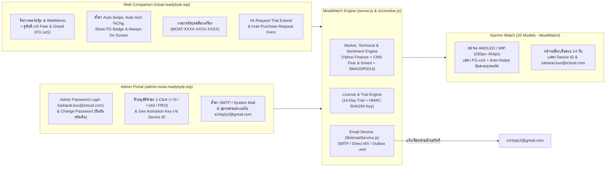

# MoatWatch — Multi-Device Garmin Portfolio Companion (2024–2026), Daily US Fear & Greed Index, Auto-Swipe, Security VA Hardened & Licensing Platform

ระบบติดตามพอร์ตหุ้นหลายพอร์ต (US / Thai SET `.BK` / Crypto), **ดัชนีจิตวิทยาตลาดหุ้นสหรัฐฯ รายวัน (Daily US Market Fear & Greed Index — `FG:xxG` / `FG:xxEF`)**, แจ้งเตือนราคาเป้าหมาย (Target/Stop Alert), อินดิเคเตอร์ครบชุด (**SMA-20 + SMA%**, **RSI-14**, **Day High/Low**, **วันประกาศงบ `e-dd/mm/yy`**, **กราฟ 14-Day Sparkline + Bollinger Bands**), และบันทึกช่วยจำ **WebMemo** ที่ออกแบบด้วยสถาปัตยกรรม **Responsive Round-Screen Layout (`260×260` ถึง `454×454` AMOLED & Solar MIP)** รองรับนาฬิกา **Garmin รุ่นยอดนิยมปี 2024–2026 รวม 20 รุ่น** พร้อมระบบ **Auto-Swipe หน้าจออัตโนมัติ**, **Auto-Sort เรียงหุ้นตาม `% Change`**, **โหมด Always-On Screen**, **ระบบแยกข้อมูลรายผู้ใช้ (Multi-User Profile & Trial Isolation)**, **ระบบทดลองใช้ฟรี 14 วัน (14-Day Trial)**, **ฟอร์มขอต่ออายุ Trial / สั่งซื้อคีย์ถาวร (Purchase Request Form)**, **บริการส่งอีเมลแจ้งเตือนไปยัง `e24qdy2@gmail.com`**, และ **หน้า Admin ออกคีย์ปลดล็อกรายเครื่อง (`Device ID`) ที่ผ่านการทำ Security / Vulnerability Assessment (VA) Hardening ครบสมบูรณ์**

---

## ✨ ฟีเจอร์ไฮไลต์ล่าสุด (Latest Release Highlights)

- 📊 **Daily US Market Fear & Greed Index (`FG:xxG` / `FG:xxEF`):**
  - ดึงค่าดัชนี **CNN US Stock Market Fear & Greed Index (0–100)** รายวันอัตโนมัติ (แคช 30 นาที พร้อมระบบ Fallback)
  - **บนหน้าเว็บ (Web Companion):** แสดงป้ายสถานะที่มุมซ้ายบนถัดจากนาฬิกาเวลาตลาดหุ้นสหรัฐฯ เช่น `US F&G: 64 · GREED (FG:64G)` พร้อมสวิตช์เปิด/ปิดการซิงก์ขึ้นหน้าปัดนาฬิกา
  - **บนหน้าจอนาฬิกา Garmin (Watch Header):** แสดงตัวย่อขนาดเล็กประหยัดพื้นที่บนแถบสถานะด้านบนสุด เช่น `14:30 · FG:64G · 5s · PRO` พร้อมแยกสีตามโซนอารมณ์ตลาด 5 ระดับ:
    - `0–24` -> **`FG:xxEF`** (*Extreme Fear* — สีแดง `#F43F5E`)
    - `25–44` -> **`FG:xxF`** (*Fear* — สีส้ม `#FB923C`)
    - `45–55` -> **`FG:xxN`** (*Neutral* — สีเทาฟ้า `#94A3B8`)
    - `56–74` -> **`FG:xxG`** (*Greed* — สีเขียวมรกต `#10B981`)
    - `75–100` -> **`FG:xxEG`** (*Extreme Greed* — สีฟ้าไซแอน `#06B6D4`)
- ⌚ **รองรับนาฬิกา Garmin 20 รุ่น (2024–2026 Lineup) & Connect IQ Store Ready (`MoatWatch.iq`):**
  - ปรับถ้อยคำและ UI ทั้งหมดบนหน้าเว็บและหน้า Admin ให้รองรับผู้ใช้ **Garmin Watch ทุกรุ่นที่รองรับ** (ไม่ได้จำกัดเฉพาะ Venu 2)
  - ปรับ `minApiLevel="3.2.0"` เพื่อความเข้ากันได้สูงสุดกับฮาร์ดแวร์จริงบน Garmin Connect IQ Store พร้อมชุดภาพ Store Assets (`dist/store-assets/`) และหน้า Privacy Policy (`/privacy`)
- 👥 **Multi-User Isolation & Hardware Auto-Device-ID:**
  - แยกพอร์ตและสิทธิ์ทดลองใช้ 14 วันตาม `Sync Key` และ `Device ID` ของแต่ละเครื่องโดยอัตโนมัติ ไม่ปะปนกันระหว่างผู้ใช้งาน

---

## ⌚ รุ่นนาฬิกา Garmin ที่รองรับ (20 Popular Models 2024–2026)

| ตระกูล (Series) | รุ่นที่รองรับ (Model Name) | Connect IQ ID | ความละเอียดหน้าจอ | ประเภทจอและการควบคุม |
| :--- | :--- | :--- | :--- | :--- |
| **Venu Series** | **Garmin Venu 3** | `venu3` | `454×454` | AMOLED · Touch + 3 Buttons |
| **Venu Series** | **Garmin Venu 3S** | `venu3s` | `390×390` | AMOLED · Touch + 3 Buttons |
| **Venu Series** | **Garmin Venu 2** | `venu2` | `416×416` | AMOLED · Touch + 2 Buttons |
| **Venu Series** | **Garmin Venu 2 Plus** | `venu2plus` | `416×416` | AMOLED · Touch + 3 Buttons |
| **Venu Series** | **Garmin Venu 2S** | `venu2s` | `360×360` | AMOLED · Touch + 2 Buttons |
| **vívoactive Series** | **Garmin vívoactive 5 / 6** | `vivoactive5` | `390×390` | AMOLED · Touch + 2 Buttons |
| **Forerunner Series** | **Garmin Forerunner 165** | `fr165` | `390×390` | AMOLED · Touch + 5 Buttons |
| **Forerunner Series** | **Garmin Forerunner 165 Music** | `fr165m` | `390×390` | AMOLED · Touch + 5 Buttons |
| **Forerunner Series** | **Garmin Forerunner 265** | `fr265` | `416×416` | AMOLED · Touch + 5 Buttons |
| **Forerunner Series** | **Garmin Forerunner 265S** | `fr265s` | `360×360` | AMOLED · Touch + 5 Buttons |
| **Forerunner Series** | **Garmin Forerunner 965** | `fr965` | `454×454` | AMOLED · Touch + 5 Buttons |
| **fēnix 8 Series** | **Garmin fēnix 8 (43mm AMOLED)** | `fenix843mm` | `416×416` | AMOLED · Touch + 5 Buttons |
| **fēnix 8 Series** | **Garmin fēnix 8 (47mm AMOLED)** | `fenix847mm` | `454×454` | AMOLED · Touch + 5 Buttons |
| **fēnix 8 Series** | **Garmin fēnix 8 (51mm AMOLED)** | `fenix851mm` | `454×454` | AMOLED · Touch + 5 Buttons |
| **fēnix 8 Solar** | **Garmin fēnix 8 Solar (47mm MIP)** | `fenix8solar47mm` | `260×260` | Solar MIP · Touch + 5 Buttons |
| **Enduro Series** | **Garmin Enduro 3 (51mm Solar MIP)** | `enduro3` | `280×280` | Solar MIP · Touch + 5 Buttons |
| **epix Pro (Gen 2)** | **Garmin epix Pro (Gen 2) 42mm** | `epix2pro42mm` | `390×390` | AMOLED · Touch + 5 Buttons |
| **epix Pro (Gen 2)** | **Garmin epix Pro (Gen 2) 47mm** | `epix2pro47mm` | `416×416` | AMOLED · Touch + 5 Buttons |
| **epix Pro (Gen 2)** | **Garmin epix Pro (Gen 2) 51mm** | `epix2pro51mm` | `454×454` | AMOLED · Touch + 5 Buttons |
| **Approach Series** | **Garmin Approach S70 (42mm / 47mm)** | `approachs7042mm`, `approachs7047mm` | `390×390` / `454×454` | AMOLED · Touch + 3 Buttons |

---

## 🛡️ Security & Vulnerability Assessment (VA) Hardening Summary

- **Zero Client-Side Credential Leaks (`C-01`):** ลบ Hint รหัสผ่านเริ่มต้นออกจาก `public/admin.html`, `public/admin.js`, และเอกสารทั้งหมด 100% (ตรวจสอบผ่าน View Page Source / DevTools จะไม่พบรหัสผ่านใดๆ)
- **Authentication Bypass Eliminated (`C-02`):** ปิดกั้น Legacy OTP Endpoint (`/api/admin/auth/request-otp` คืนค่า `HTTP 403`) และป้องกันการปลอมแปลง Header `cf-access-authenticated-user-email` หากไม่มี `cf-access-jwt-assertion`
- **Secret Externalization (`C-03` & `C-04`):** แยก `LICENSE_HMAC_SECRET` และ `ADMIN_INITIAL_PASSWORD` ไปไว้ในไฟล์ `.env` (ซึ่งอยู่ใน `.gitignore`) และถอนไฟล์ `data/licenses.json` กับ `data/mail-outbox/*.eml` ออกจาก Git Tracking
- **Public API Data Redaction (`H-01`):** ซ่อนค่า `issuedKey` ใน Public API (`/api/portfolio` และ `/api/device/status`) หากเครื่องนั้นยังอยู่ในสถานะ `TRIAL` หรือ `EXPIRED`
- **Brute-Force Lockout & IP Rate Limiting (`H-02`):** ล็อก IP ทันที 15 นาที (`HTTP 429`) เมื่อล็อกอิน Admin ผิดครบ 5 ครั้ง และจำกัดความถี่การยิง `/api/device/activate` กับ `/api/license/request`
- **Security Headers & Cookie Hardening (`M-01`..`M-03`):** บังคับใช้ `Content-Security-Policy (CSP)`, `Strict-Transport-Security (HSTS)`, `X-Frame-Options: DENY`, `X-Content-Type-Options: nosniff`, `Cache-Control: no-store`, Restricted CORS และคุกกี้ `__moat_admin_session` แบบ `HttpOnly; SameSite=Strict`

---

## 🌐 Live Endpoints บน Cloudflare (`readybyte.top`)

| บริการ | URL เข้าใช้งาน | รายละเอียด |
| :--- | :--- | :--- |
| **Web Companion & Garmin Watch Simulator** | **[`https://moat.readybyte.top`](https://moat.readybyte.top)** | จัดการพอร์ตหุ้น, ดูค่า **US Market Fear & Greed Index (`FG:xxG`)**, จดบันทึก WebMemo, ตั้งค่า **Auto-Sort `% Change`**, ตั้งค่า Auto-Swipe (`5s`/Custom), Always-On Display, สวิตช์แสดง `FG:xx` บนนาฬิกา, ใส่ Activation Key, กด **Request Trial Key Extend** และกรอก **Purchase Request Form** |
| **Admin Licensing Portal (Subdomain)** | **[`https://admin-moat.readybyte.top`](https://admin-moat.readybyte.top)** | หน้าบริหารจัดการสำหรับเจ้าของระบบ (**`saharat.bun@icloud.com`**) เข้าสู่ระบบด้วย **Admin Password** เพื่ออนุมัติคำขอจากลูกค้า, ตั้งค่า SMTP ส่งเมลไปที่ **`e24qdy2@gmail.com`**, และสร้าง Activation Key ราย `Device ID` |
| **Garmin Watch JSON API** | **[`https://moat.readybyte.top/api/watch?key=VENU2-88`](https://moat.readybyte.top/api/watch?key=VENU2-88)** | Compact JSON Endpoint (`<4KB`) สำหรับแอปนาฬิกา Garmin ทั้ง 20 รุ่น พร้อมฟิลด์ `fg` (`FG:xxG`) และ `cfg.sfg` |
| **Privacy Policy (Connect IQ Store)** | **[`https://moat.readybyte.top/privacy`](https://moat.readybyte.top/privacy)** | หน้าประกาศนโยบายความเป็นส่วนตัวมาตรฐานสำหรับ Garmin Connect IQ Store |

---

## 📚 สารบัญเอกสารคู่มือและสถาปัตยกรรม (Detailed Documentation)

เอกสารทั้งหมดจัดทำอย่างละเอียดพร้อมแผนภาพ **App Design**, **App Flow**, และ **Logic Flow**:

1. 📖 **[คู่มือการใช้งานฉบับสมบูรณ์ (User, Garmin Watch & Admin Manual)](./docs/01-USER-AND-ADMIN-MANUAL.md)**
   - วิธีติดตั้งแอป **MoatWatch** ผ่าน Garmin Connect IQ Store หรือผ่านสาย USB MTP (`MoatWatch.prg` / `Venu2Moat.prg`)
   - วิธีใช้งานปุ่มกดและการปัดหน้าจอบนนาฬิกา Garmin ทั้ง 20 รุ่น
   - วิธีดูค่า **Daily US Fear & Greed Index (`FG:xxG`)**, ตั้งค่า **Auto-Swipe**, **Auto-Sort `% Change`**, และ **Always-On Screen** ผ่านเว็บ
   - การใช้งานระบบ **Trial 14 วัน**, การกด **Request Trial Key Extend**, การกรอก **Purchase Request Form**, และการอนุมัติคำขอในหน้า **Admin Portal**
2. 🎨 **[การออกแบบแอปและพิกัดหน้าจอนาฬิกา Garmin (App Design & UI Spec)](./docs/02-APP-DESIGN-AND-UI-SPEC.md)**
   - สถาปัตยกรรม **Proportional Layout (`MoatWatchLayout.mc`)** รองรับหน้าจอกลม `260×260` ถึง `454×454` และการประหยัดพลังงานด้วย True Void Black (`#000000`)
   - ผังพิกัดหน้าจอทั้ง 3 หน้าจอหลัก (Portfolio View พร้อมป้าย `FG:xxG`, Symbol Detail + Sparkline + WebMemo View, และ 14-Day Trial Expired Lock Screen)
   - ระบบสี 5 โซนของ **Fear & Greed Index** และแผนภาพคลาส Monkey C (`Class Diagram`)
3. 🔄 **[ลำดับการทำงานและตรรกะของระบบ (App Flow & Logic Flow)](./docs/03-APP-FLOW-AND-LOGIC-FLOW.md)**
   - แผนภาพสถาปัตยกรรม End-to-End (`Cloudflare Worker / Tunnel` ⇄ `MoatEngine` ⇄ `Garmin Watch` ⇄ `SMTP/System Mail -> e24qdy2@gmail.com`)
   - Sequence Diagram การเปิดแอปและการซิงค์ข้อมูลแบบ Offline-First + Auto-Device-ID
   - Flowchart ตรรกะการทำงานของ **1-Second Runtime Timer**, **Auto-Swipe Pagination**, และ **Daily US Fear & Greed Fetcher (30-Min Cache)**
   - State Machine & อัลกอริทึม **HMAC-SHA256 Per-Device Activation Key** (`MOAT-XXXX-XXXX-XXXX`)
4. 🛠️ **[เอกสารอ้างอิง API, โครงสร้างข้อมูล และ SDLC (API & SDLC Reference)](./docs/04-API-AND-SDLC-REFERENCE.md)**
   - แผนภาพฐานข้อมูล (`ER Diagram`) ของ `portfolios.json`, `licenses.json`, และ `data/mail-outbox/*.eml`
   - รายละเอียด REST API ทุก Endpoint พร้อมตัวอย่าง JSON (รวมอ็อบเจกต์ `fearGreed` และ `fg`)
   - คู่มือการรันชุดทดสอบอัตโนมัติครบ **16 ชุด (`tests/sdlc.test.js`)**

---

## 🏗️ แผนภาพภาพรวมการทำงานของระบบ (High-Level System Flow)



---

## 📂 โครงสร้างไฟล์ในโปรเจกต์ (Project Structure)

```text
garmin-venu2-moat/
├── README.md                          # หน้าหลักสรุปภาพรวมและสารบัญเอกสาร
├── docs/                              # คู่มือการใช้งานและเอกสารการออกแบบระบบอย่างละเอียด
│   ├── 01-USER-AND-ADMIN-MANUAL.md    # คู่มือผู้ใช้, นาฬิกา Garmin 20 รุ่น, Fear & Greed, ฟอร์มสั่งซื้อ และหน้า Admin
│   ├── 02-APP-DESIGN-AND-UI-SPEC.md   # พิกัดหน้าจอ Garmin (260x260–454x454), โซนสี FG:xx & Class Diagram
│   ├── 03-APP-FLOW-AND-LOGIC-FLOW.md  # Sequence Diagrams, State Machines & Logic Flows
│   └── 04-API-AND-SDLC-REFERENCE.md   # ER Diagram, REST API Docs & SDLC Test Guide (16 Suites)
├── server.js                          # เซิร์ฟเวอร์หลัก Node.js (Web API + Watch API + Admin Subdomain Router)
├── src/
│   └── worker.js                      # Cloudflare Worker Serverless Bundle (Edge Deployment Ready)
├── lib/
│   ├── moatEngine.js                  # Deep Module คำนวณพอร์ต, อินดิเคเตอร์หุ้น, และดัชนี US Fear & Greed (FG:xxG)
│   ├── garminDevices.js               # ตารางข้อมูลจำเพาะนาฬิกา Garmin 20 รุ่น (2024–2026)
│   ├── licenseManager.js              # เอ็นจิ้นจัดการ Trial 14 วัน, คิวคำขอลูกค้า, HMAC Key & Admin Password
│   └── emailService.js                # เอ็นจิ้นส่งอีเมลแจ้งเตือนไปที่ e24qdy2@gmail.com (SMTP TLS + Direct MX + Outbox)
├── public/
│   ├── index.html                     # หน้าเว็บหลัก Web Companion + Garmin Simulator + ป้าย US Fear & Greed
│   ├── app.js                         # ลอจิกหน้าเว็บหลัก, Auto-Swipe Simulator, Settings Sync & Request Form
│   ├── watchSimulator.js              # โมดูลจำลองการวาดหน้าปัดนาฬิกา Garmin บนเว็บ (ตรงกับ Monkey C 100%)
│   ├── admin.html                     # หน้าเว็บ Admin Portal (https://admin-moat.readybyte.top)
│   ├── admin.js                       # ลอจิกหน้า Admin, อนุมัติคำขอ 1 คลิก, ตั้งค่า SMTP & Key Generator
│   ├── privacy.html                   # หน้านโยบายความเป็นส่วนตัว (/privacy) สำหรับ Garmin Connect IQ Store
│   └── styles.css                     # สไตล์เสริมสำหรับหน้าเว็บ
├── garmin-venu2-app/                  # ซอร์สโค้ดแอปนาฬิกา Garmin Connect IQ (Monkey C)
│   ├── manifest.xml                   # กำหนดค่าแอป MoatWatch รองรับ Garmin 20 รุ่น (minApiLevel 3.2.0)
│   ├── monkey.jungle                  # ไฟล์ตั้งค่าการคอมไพล์ Connect IQ
│   ├── resources/                     # ไอคอน, ฟอนต์, Strings และ Settings Properties XML
│   └── source/
│       ├── Venu2MoatApp.mc            # จุดเริ่มต้นแอปและการควบคุม Runtime Timer
│       ├── MoatWatchLayout.mc         # Deep Module คำนวณพิกัดหน้าจอตามสัดส่วน (260px–454px) & แถบสถานะ FG:xx
│       ├── PortfolioStore.mc          # จัดการข้อมูล, Fear & Greed State, Auto-Swipe, Always-On & License
│       ├── Venu2MoatView.mc           # วาดหน้าจอหลัก, ป้ายสี FG:xxG และหน้าจอล็อก Trial 14d Expired
│       ├── Venu2MoatDelegate.mc       # รับอินพุตปุ่มกดและการปัด/แตะหน้าจอ
│       ├── SymbolDetailView.mc        # วาดกราฟ Sparkline, SMA-20, Bollinger และ WebMemo
│       ├── SymbolDetailDelegate.mc    # รับอินพุตในหน้ารายละเอียดหุ้น
│       └── Venu2MoatGlanceView.mc     # วาด Widget Glance บนหน้ารวมของนาฬิกา
├── dist/
│   ├── MoatWatch.iq                   # แพ็กเกจสำหรับอัปโหลดขึ้น Garmin Connect IQ Store (20 รุ่น)
│   ├── MoatWatch.prg / Venu2Moat.prg  # ไฟล์ไบนารีที่คอมไพล์แล้วสำหรับ Sideload ลงนาฬิกา Garmin
│   └── store-assets/                  # ภาพประกอบสำหรับอัปโหลดขึ้น Connect IQ Store (Cover, Hero, Screenshots, Icons)
├── tests/
│   └── sdlc.test.js                   # ชุดทดสอบอัตโนมัติ End-to-End ครบ 16 ส่วนตามมาตรฐาน SDLC
├── build-and-sideload.ps1             # สคริปต์คอมไพล์ .prg + Sideload ผ่าน MTP USB + Auto-Sync GitHub
├── start-cloudflare-domain.ps1        # สคริปต์รัน Cloudflare Tunnel สำหรับ moat & admin-moat.readybyte.top
└── sync-github.ps1                    # สคริปต์ Commit & Push การเปลี่ยนแปลงขึ้น GitHub อัตโนมัติ
```

---

## 🚀 คำสั่งใช้งานด่วน (Quick Commands)

```powershell
# 1. รันเซิร์ฟเวอร์ Web Companion + Watch API + Admin Portal (พอร์ต 3880)
npm start

# 2. รันชุดทดสอบอัตโนมัติ SDLC ทั้ง 16 ชุด (100% Green)
npm test

# 3. คอมไพล์แอปนาฬิกา Garmin (.prg) และส่งเข้านาฬิกาผ่านสาย USB MTP
npm run build:watch

# 4. สร้างบันเดิลสำหรับ Cloudflare Worker
npm run cf:bundle

# 5. อัปเดตซอร์สโค้ดและเอกสารล่าสุดขึ้น GitHub Repository อัตโนมัติ
npm run git:sync
```
