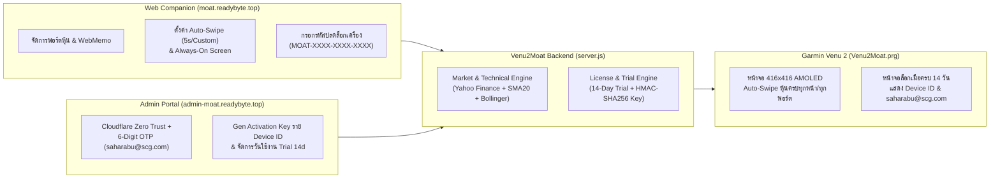

# Venu2Moat — Garmin Venu 2 Portfolio, Auto-Swipe & Licensing Platform

ระบบติดตามพอร์ตหุ้น (US / Thai SET `.BK` / Crypto), แจ้งเตือนราคาเป้าหมาย (Target/Stop Alert), กราฟ Sparkline + SMA-20 + Bollinger Bands, และบันทึกช่วยจำ **WebMemo** ที่ออกแบบมาเฉพาะสำหรับหน้าจอ **Garmin Venu 2 (416×416 Round AMOLED)** พร้อมระบบ **Auto-Swipe หน้าจออัตโนมัติ**, **โหมด Always-On Screen**, **ระบบทดลองใช้ฟรี 14 วัน (14-Day Trial)** และ **หน้า Admin ออกคีย์ปลดล็อกรายเครื่อง (`Device ID`)**

---

## 🌐 Live Endpoints บน Cloudflare (`readybyte.top`)

| บริการ | URL เข้าใช้งาน | รายละเอียด |
| :--- | :--- | :--- |
| **Web Companion & 416×416 Simulator** | **[`https://moat.readybyte.top`](https://moat.readybyte.top)** | จัดการพอร์ตหุ้น, จดบันทึก WebMemo, ตั้งค่า Auto-Swipe (`5s`/Custom) & Always-On Display, และใส่ Activation Key |
| **Admin Licensing Portal (Subdomain)** | **[`https://admin-moat.readybyte.top`](https://admin-moat.readybyte.top)** | หน้าบริหารจัดการสำหรับเจ้าของแอป (**`saharabu@scg.com`**) รองรับ Cloudflare Zero Trust Access & 6-Digit OTP เพื่อสร้าง Activation Key ราย `Device ID` |
| **Garmin Venu 2 Watch JSON API** | **[`https://moat.readybyte.top/api/watch?key=VENU2-88`](https://moat.readybyte.top/api/watch?key=VENU2-88)** | Compact JSON Endpoint (`<4KB`) สำหรับแอปนาฬิกา Garmin Venu 2 |

---

## 📚 สารบัญเอกสารคู่มือและสถาปัตยกรรม (Detailed Documentation)

เอกสารทั้งหมดจัดทำอย่างละเอียดพร้อมแผนภาพ **App Design**, **App Flow**, และ **Logic Flow**:

1. 📖 **[คู่มือการใช้งานฉบับสมบูรณ์ (User, Watch & Admin Manual)](./docs/01-USER-AND-ADMIN-MANUAL.md)**
   - วิธีติดตั้งไฟล์ `Venu2Moat.prg` ลงนาฬิกา Garmin Venu 2 ผ่านสาย USB MTP
   - วิธีใช้งานปุ่มกดและการปัดหน้าจอบนนาฬิกา
   - วิธีตั้งค่า **Auto-Swipe (ค่าเริ่มต้น 5 วินาที / กำหนดเอง 2–120 วินาที)** และ **Always-On Screen** ผ่านเว็บ
   - การใช้งานระบบ **Trial 14 วัน**, การติดต่อ **`saharabu@scg.com`** เมื่อหมดเวลา และการออกคีย์ในหน้า **Admin Portal**
2. 🎨 **[การออกแบบแอปและพิกัดหน้าจอ 416×416 AMOLED (App Design & UI Spec)](./docs/02-APP-DESIGN-AND-UI-SPEC.md)**
   - ข้อจำกัดฮาร์ดแวร์ Garmin Venu 2 และการประหยัดพลังงานด้วย True Void Black (`#000000`)
   - ผังพิกัดหน้าจอ 416×416 พิกเซลทั้ง 3 หน้าจอหลัก (Portfolio View, Symbol Detail + Sparkline + WebMemo View, และ 14-Day Trial Expired Lock Screen)
   - แผนภาพคลาส Monkey C (`Class Diagram`)
3. 🔄 **[ลำดับการทำงานและตรรกะของระบบ (App Flow & Logic Flow)](./docs/03-APP-FLOW-AND-LOGIC-FLOW.md)**
   - แผนภาพสถาปัตยกรรม End-to-End (`Cloudflare Tunnel` ⇄ `Node.js Server` ⇄ `Garmin Venu 2`)
   - Sequence Diagram การเปิดแอปและการซิงค์ข้อมูลแบบ Offline-First
   - Flowchart ตรรกะการทำงานของ **1-Second Runtime Timer** สำหรับ **Auto-Swipe Pagination** และ **Always-On Backlight**
   - State Machine & อัลกอริทึม **HMAC-SHA256 Per-Device Activation Key** (`MOAT-XXXX-XXXX-XXXX`)
4. 🛠️ **[เอกสารอ้างอิง API, โครงสร้างข้อมูล และ SDLC (API & SDLC Reference)](./docs/04-API-AND-SDLC-REFERENCE.md)**
   - แผนภาพฐานข้อมูล (`ER Diagram`) ของ `portfolios.json` และ `licenses.json`
   - รายละเอียด REST API ทุก Endpoint พร้อมตัวอย่าง JSON
   - คู่มือการรันชุดทดสอบอัตโนมัติ 6 ชุด (`tests/sdlc.test.js`)

---

## 🏗️ แผนภาพภาพรวมการทำงานของระบบ (High-Level System Flow)



---

## 📂 โครงสร้างไฟล์ในโปรเจกต์ (Project Structure)

```text
garmin-venu2-moat/
├── README.md                          # หน้าหลักสรุปภาพรวมและสารบัญเอกสาร
├── docs/                              # คู่มือการใช้งานและเอกสารการออกแบบระบบอย่างละเอียด
│   ├── 01-USER-AND-ADMIN-MANUAL.md    # คู่มือผู้ใช้, นาฬิกา Garmin Venu 2 และหน้า Admin
│   ├── 02-APP-DESIGN-AND-UI-SPEC.md   # พิกัดหน้าจอ 416x416 AMOLED & Class Diagram
│   ├── 03-APP-FLOW-AND-LOGIC-FLOW.md  # Sequence Diagrams, State Machines & Logic Flows
│   └── 04-API-AND-SDLC-REFERENCE.md   # ER Diagram, REST API Docs & SDLC Test Guide
├── server.js                          # เซิร์ฟเวอร์หลัก (Web API + Watch API + Admin Subdomain Router)
├── lib/
│   └── licenseManager.js              # เอ็นจิ้นจัดการ Trial 14 วัน, HMAC Activation Key & Admin OTP
├── public/
│   ├── index.html                     # หน้าเว็บหลัก Web Companion + 416x416 Interactive Simulator
│   ├── app.js                         # ลอจิกหน้าเว็บหลัก, Auto-Swipe Simulator & Settings Sync
│   ├── admin.html                     # หน้าเว็บ Admin Portal (https://admin-moat.readybyte.top)
│   ├── admin.js                       # ลอจิกหน้า Admin, OTP Login & Per-Device Key Generator
│   └── styles.css                     # สไตล์เสริมสำหรับหน้าเว็บ
├── garmin-venu2-app/                  # ซอร์สโค้ดแอปนาฬิกา Garmin Connect IQ (Monkey C)
│   ├── manifest.xml                   # กำหนดค่าแอปสำหรับ Garmin Venu 2 (venu2)
│   ├── monkey.jungle                  # ไฟล์ตั้งค่าการคอมไพล์ Connect IQ
│   ├── resources/                     # ไอคอน, ฟอนต์, Strings และ Settings Properties XML
│   └── source/
│       ├── Venu2MoatApp.mc            # จุดเริ่มต้นแอปและการควบคุม Runtime Timer
│       ├── PortfolioStore.mc          # จัดการข้อมูล, Auto-Swipe, Always-On Backlight & License State
│       ├── Venu2MoatView.mc           # วาดหน้าจอหลัก 416x416 และหน้าจอล็อก Trial 14d Expired
│       ├── Venu2MoatDelegate.mc       # รับอินพุตปุ่มกดและการปัด/แตะหน้าจอ
│       ├── SymbolDetailView.mc        # วาดกราฟ Sparkline, SMA-20, Bollinger และ WebMemo
│       ├── SymbolDetailDelegate.mc    # รับอินพุตในหน้ารายละเอียดหุ้น
│       └── Venu2MoatGlanceView.mc     # วาด Widget Glance บนหน้ารวมของนาฬิกา
├── dist/
│   └── Venu2Moat.prg                  # ไฟล์ไบนารีที่คอมไพล์แล้วสำหรับติดตั้งลง Garmin Venu 2
├── tests/
│   └── sdlc.test.js                   # ชุดทดสอบอัตโนมัติ End-to-End ครบ 6 ส่วนตามมาตรฐาน SDLC
├── build-and-sideload.ps1             # สคริปต์คอมไพล์ .prg + Sideload ผ่าน MTP USB + Auto-Sync GitHub
├── start-cloudflare-domain.ps1        # สคริปต์รัน Cloudflare Tunnel สำหรับ moat & admin-moat.readybyte.top
└── sync-github.ps1                    # สคริปต์ Commit & Push การเปลี่ยนแปลงขึ้น GitHub อัตโนมัติ
```

---

## 🚀 คำสั่งใช้งานด่วน (Quick Commands)

```powershell
# 1. รันเซิร์ฟเวอร์ Web Companion + Watch API + Admin Portal (พอร์ต 3880)
npm start

# 2. รันชุดทดสอบอัตโนมัติ SDLC ทั้ง 6 ชุด (100% Green)
npm test

# 3. คอมไพล์แอป Venu2Moat.prg และส่งเข้านาฬิกาผ่านสาย USB MTP (พร้อม Sync ขึ้น GitHub)
npm run build:watch

# 4. อัปเดตซอร์สโค้ดล่าสุดขึ้น GitHub Repository อัตโนมัติ
npm run git:sync
```
