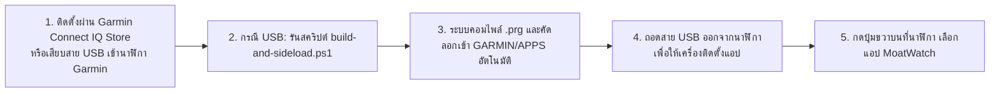
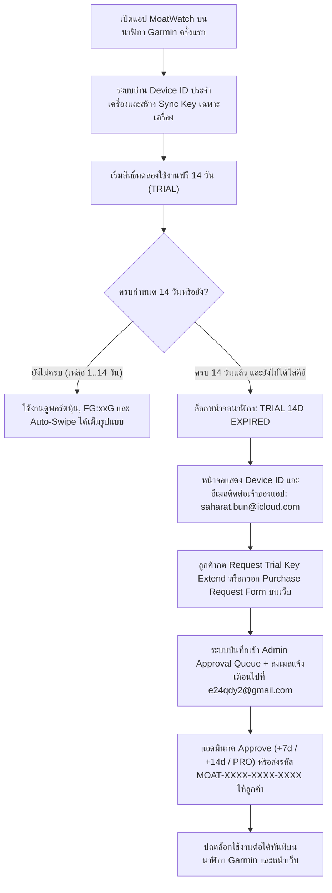

# คู่มือการใช้งานระบบ MoatWatch อย่างละเอียด (User, Garmin Watch & Admin Manual)

เอกสารฉบับนี้เป็นคู่มือการใช้งานฉบับสมบูรณ์สำหรับระบบ **MoatWatch** ครอบคลุมทั้งฝั่งผู้ใช้งานบนนาฬิกา **Garmin ทั้ง 20 รุ่นที่รองรับ (2024–2026)**, หน้าเว็บ **Web Companion (`https://moat.readybyte.top`)**, ฟีเจอร์ดัชนีจิตวิทยาตลาดหุ้นสหรัฐฯ **Daily US Market Fear & Greed Index (`FG:xxG` / `FG:xxEF`)**, ฟอร์มขอต่ออายุและสั่งซื้อคีย์ (**Request Trial Key Extend & Purchase Request Form**), ระบบแจ้งเตือนทางอีเมลไปยัง **`e24qdy2@gmail.com`**, และหน้าผู้ดูแลระบบ **Admin Licensing Portal (`https://admin-moat.readybyte.top`)** ของเจ้าของระบบ (**`saharat.bun@icloud.com`**)

---

## สารบัญ (Table of Contents)
1. [ภาพรวมระบบและ URL เข้าใช้งาน](#1-ภาพรวมระบบและ-url-เข้าใช้งาน)
2. [คู่มือการติดตั้งแอปลงนาฬิกา Garmin (Connect IQ Store & USB MTP Sideload)](#2-คู่มือการติดตั้งแอปลงนาฬิกา-garmin-connect-iq-store--usb-mtp-sideload)
3. [คู่มือการใช้งานแอปบนนาฬิกา Garmin และความหมายของป้ายสถานะ `FG:xx`](#3-คู่มือการใช้งานแอปบนนาฬิกา-garmin-และความหมายของป้ายสถานะ-fgxx)
4. [คู่มือการตั้งค่า Auto-Swipe, Auto-Sort `% Change`, US Fear & Greed & Always-On Screen ผ่านเว็บ](#4-คู่มือการตั้งค่า-auto-swipe-auto-sort--change-us-fear--greed--always-on-screen-ผ่านเว็บ)
5. [คู่มือการจัดการพอร์ตหุ้น, วันประกาศงบ (`e-dd/mm/yy`), ราคาเป้าหมาย (Alert) และ WebMemo](#5-คู่มือการจัดการพอร์ตหุ้น-วันประกาศงบ-e-ddmmyy-ราคาเป้าหมาย-alert-และ-webmemo)
6. [คู่มือระบบ Trial 14 วัน, การกดขอต่ออายุ Trial, ฟอร์มสั่งซื้อ License และการปลดล็อก Paid Version (`saharat.bun@icloud.com`)](#6-คู่มือระบบ-trial-14-วัน-การกดขอต่ออายุ-trial-ฟอร์มสั่งซื้อ-license-และการปลดล็อก-paid-version-saharatbunicloudcom)
7. [คู่มือผู้ดูแลระบบ Admin Licensing Portal & ระบบอีเมลแจ้งเตือน (`https://admin-moat.readybyte.top`)](#7-คู่มือผู้ดูแลระบบ-admin-licensing-portal--ระบบอีเมลแจ้งเตือน-httpsadmin-moatreadybytetop)

---

## 1. ภาพรวมระบบและ URL เข้าใช้งาน

| ระบบ | URL / ช่องทางเข้าถึง | รายละเอียดหน้าที่ |
| :--- | :--- | :--- |
| **Web Companion App** | [`https://moat.readybyte.top`](https://moat.readybyte.top) | จัดการพอร์ตหุ้น, ดูดัชนี **US Market Fear & Greed (`FG:xxG`)** มุมซ้ายบน, จดบันทึก WebMemo, ตั้งค่า Auto-Swipe / Auto-Sort / Always-On, จำลองหน้าปัดนาฬิกา Garmin ทั้ง 20 รุ่น, กรอกคีย์ปลดล็อกเครื่อง, กด **Request Trial Key Extend** และกรอก **Purchase Request Form** |
| **Admin Licensing Portal** | [`https://admin-moat.readybyte.top`](https://admin-moat.readybyte.top) | ระบบหลังบ้านเฉพาะเจ้าของระบบ (`saharat.bun@icloud.com`) สำหรับอนุมัติคำขอต่ออายุ/ซื้อคีย์ใน 1 คลิก, สร้าง Activation Key ราย `Device ID`, และตั้งค่า SMTP ส่งเมลแจ้งเตือนไปที่ `e24qdy2@gmail.com` |
| **Garmin Watch API** | `https://moat.readybyte.top/api/watch?key=VENU2-88` | Endpoint JSON ขนาดกะทัดรัด (`<4KB`) ที่นาฬิกา Garmin ดึงผ่าน Bluetooth / Wi-Fi |
| **Connect IQ Store Package** | `dist/MoatWatch.iq` | แพ็กเกจสำหรับอัปโหลดขึ้น Garmin Connect IQ Store รองรับนาฬิกา Garmin 20 รุ่น (`minApiLevel="3.2.0"`) |
| **Garmin Binary (`.prg`)** | `dist/MoatWatch.prg` / `dist/Venu2Moat.prg` | ไฟล์แอปพลิเคชันสำหรับติดตั้งผ่านสาย USB ลงใน `Internal Storage\GARMIN\APPS\` ของนาฬิกา |

---

## 2. คู่มือการติดตั้งแอปลงนาฬิกา Garmin (Connect IQ Store & USB MTP Sideload)



### วิธีที่ 1: ติดตั้งผ่าน Garmin Connect IQ Store (แนะนำสำหรับผู้ใช้งานทั่วไป)
1. เปิดแอป **Garmin Connect IQ Store** บนสมาร์ทโฟนของคุณ
2. ค้นหาแอป **MoatWatch** (หรือเข้าผ่านลิงก์ Beta / Store Listing) แล้วกด **Install**
3. ซิงก์นาฬิกาผ่านแอป **Garmin Connect** แอปจะปรากฏในรายการแอปบนนาฬิกา Garmin ของคุณทันที

### วิธีที่ 2: ติดตั้งผ่านสาย USB (Sideload สำหรับนักพัฒนา)
1. เสียบสาย USB เชื่อมต่อนาฬิกา **Garmin** เข้ากับคอมพิวเตอร์ (โหมด MTP)
2. เปิด PowerShell ที่โฟลเดอร์โปรเจกต์ `D:\all-workspace\garmin-venu2` แล้วรันคำสั่ง:
   ```powershell
   npm run build:watch
   # หรือระบุรุ่นที่ต้องการคอมไพล์ เช่น venu2, venu3, fr265, fenix847mm
   powershell -NoProfile -ExecutionPolicy Bypass -File .\build-and-sideload.ps1 -Device venu2
   ```
3. ถอดสาย USB ออกจากนาฬิกา เพื่อให้ระบบปฏิบัติการของ Garmin ติดตั้งไฟล์ `.prg` เข้าสู่เมนูแอป

---

## 3. คู่มือการใช้งานแอปบนนาฬิกา Garmin และความหมายของป้ายสถานะ `FG:xx`

แอป **MoatWatch** รองรับหน้าจอนาฬิกา Garmin ทั้งแบบสัมผัสและปุ่มกด (`260×260` ถึง `454×454` พิกเซล) โดยมีวิธีควบคุมดังนี้:

| การกระทำบนนาฬิกา | ตำแหน่ง / ปุ่ม | ผลลัพธ์การทำงาน |
| :--- | :--- | :--- |
| **กดปุ่มขวาบน (Select / Start Button)** | ปุ่มกายภาพด้านขวาบน | สลับการแสดงผลกำไร/ขาดทุนระหว่าง **DAY P&L (รายวัน)** และ **TOTAL RETURN (รวมทั้งหมด)** (หรือกดเพื่อตรวจสอบสิทธิ์ใหม่หากอยู่ในหน้าจอ Trial Expired) |
| **กดค้างปุ่มขวาล่าง / ปุ่ม Menu** | ปุ่มกายภาพ Back / Menu | สั่งดึงข้อมูลพอร์ต, ดัชนี Fear & Greed และสถานะ License ล่าสุดจากเซิร์ฟเวอร์ (`fetchRemote()`) ทันที |
| **ปัดซ้าย / ปัดขวา (`SWIPE_LEFT` / `RIGHT`)** | หน้าจอสัมผัส | สลับไปยังพอร์ตโฟลิโอก่อนหน้า / ถัดไป (เช่น `US Wide Moat` ⇄ `Thai Dividend` ⇄ `Watchlist`) |
| **ปัดขึ้น / ปัดลง (`SWIPE_UP` / `DOWN`)** | หน้าจอสัมผัส / ปุ่ม Up-Down | เลื่อนดูรายชื่อหุ้นขึ้น-ลงทีละแถวภายในพอร์ตปัจจุบัน |
| **แตะที่แถบเวลาด้านบนสุด (`y < 40px`)** | ขอบบนของหน้าจอ | เปิด / ปิดโหมด **Auto-Swipe** อย่างรวดเร็วจากหน้าปัดนาฬิกาโดยตรง |
| **แตะที่ชื่อหุ้นในตาราง** | แถวรายการหุ้น | เปิดหน้า **Symbol Detail View** เพื่อดูกราฟ **14-Day Sparkline**, เส้น **SMA-20**, กรอบ **Bollinger Bands**, ราคาเป้าหมาย และบันทึก **WebMemo** |
| **แตะในหน้า Symbol Detail View** | หน้าจอรายละเอียดหุ้น | เปิด / ปิดเส้นอินดิเคเตอร์ **SMA-20 / Bollinger Overlay** |

### สัญลักษณ์สถานะบนแถบด้านบนสุดของหน้าปัด (`Top Status Bar`)
- ตัวอย่าง: **`14:30 · FG:64G · 5s · PRO`** หรือ **`14:30 · FG:18EF · 5s · 14d`**
  - **`FG:64G` / `FG:18EF`**: ดัชนี **Daily US Market Fear & Greed Index (0–100)** ของตลาดหุ้นสหรัฐฯ ในรูปแบบตัวย่อพร้อมสีประจำโซน:
    - 🔴 **`FG:xxEF`** (`0–24`): **Extreme Fear** — ตลาดกลัวสุดขีด (โซนสีแดง `#F43F5E`)
    - 🟠 **`FG:xxF`** (`25–44`): **Fear** — ตลาดมีความกลัว (โซนสีส้ม `#FB923C`)
    - ⚪ **`FG:xxN`** (`45–55`): **Neutral** — ตลาดเป็นกลาง (โซนสีเทาฟ้า `#94A3B8`)
    - 🟢 **`FG:xxG`** (`56–74`): **Greed** — ตลาดมีความโลภ/คึกคัก (โซนสีเขียวมรกต `#10B981`)
    - 🔵 **`FG:xxEG`** (`75–100`): **Extreme Greed** — ตลาดโลภสุดขีด (โซนสีฟ้าไซแอน `#06B6D4`)
  - **`5s`**: เปิดโหมด Auto-Swipe เลื่อนหน้าหุ้นอัตโนมัติทุกๆ 5 วินาที (เปลี่ยนตามเวลาที่ตั้งจากหน้าเว็บ)
  - **`AON`**: เปิดโหมด Always-On Display (หน้าจอไม่ดับขณะเปิดแอป)
  - **`14d`**: จำนวนวันที่เหลือของช่วงทดลองใช้ฟรี (Free Trial 14 วัน)
  - **`PRO`**: เครื่องนี้ได้รับการ Activate ด้วยคีย์ถาวรเรียบร้อยแล้ว

---

## 4. คู่มือการตั้งค่า Auto-Swipe, Auto-Sort `% Change`, US Fear & Greed & Always-On Screen ผ่านเว็บ

ผู้ใช้งานสามารถปรับพฤติกรรมหน้าจอนาฬิกา Garmin ได้จากหน้าเว็บ [`https://moat.readybyte.top`](https://moat.readybyte.top) ในส่วนการ์ด **"ตั้งค่าการแสดงผลบนนาฬิกา Garmin"**:

1. **Auto-Swipe Next Screen (`เปิด/ปิด` + `เวลาวินาที`)**:
   - เมื่อเปิดสวิตช์ นาฬิกาจะเลื่อนดูหุ้นทีละหน้า (หน้าละ 4 ตัว) และเมื่อครบทุกหน้าในพอร์ตนั้น จะสลับไปยังพอร์ตถัดไปให้อัตโนมัติวนไปเรื่อยๆ
   - **ค่าเริ่มต้น (Default):** `5s` (5 วินาที) หรือตั้งค่าเองได้ตั้งแต่ `2` ถึง `120` วินาที
2. **เรียงลำดับหุ้นอัตโนมัติตาม `% Change` (`ASC` / `DESC`)**:
   - เลือกให้เรียงจาก **ติดลบมากสุด → กำไรมากสุด (`ASC`)** หรือ **กำไรมากสุด → ติดลบมากสุด (`DESC`)** จากบนลงล่างได้ในคลิกเดียว
3. **แสดงดัชนี US Fear & Greed (`FG:xx`) บนหัวจอนาฬิกา**:
   - ค่าเริ่มต้นจะ **เปิด (`ON`)** เพื่อแสดงตัวย่อ `FG:xxG` บนแถบด้านบนสุดของหน้าปัดนาฬิกา Garmin (สามารถกดปิดสวิตช์ได้หากต้องการแสดงเฉพาะเวลาและสถานะปกติ)
   - บนหน้าเว็บหลัก ด้านซ้ายบนถัดจากเวลาตลาดหุ้นสหรัฐฯ จะแสดงป้ายเต็มรูปแบบ `US F&G: 64 · GREED (FG:64G)` เสมอ
4. **Always-On Screen (`ไม่บังคับเปิด`)**:
   - ค่าเริ่มต้นจะ **ปิด (`OFF`)** เพื่อประหยัดแบตเตอรี่ หากต้องการเปิดดูพอร์ตแบบไม่ให้หน้าจอดับ สามารถเปิดสวิตช์ได้ทันที

---

## 5. คู่มือการจัดการพอร์ตหุ้น, วันประกาศงบ (`e-dd/mm/yy`), ราคาเป้าหมาย (Alert) และ WebMemo

บนหน้าเว็บ [`https://moat.readybyte.top`](https://moat.readybyte.top):
1. **การเปลี่ยนสกุลเงินหลัก (`THB ฿` / `USD $`)**:
   - กดปุ่มสกุลเงินมุมขวาบน ระบบจะคำนวณมูลค่าพอร์ตรวมและกำไร/ขาดทุนด้วยอัตราแลกเปลี่ยน `USD/THB` แบบเรียลไทม์
2. **การเพิ่ม/แก้ไขหุ้นและอินดิเคเตอร์สำคัญ**:
   - พิมพ์ชื่อย่อหุ้น เช่น `NVDA`, `MSFT`, `ADVANC.BK`, `DELTA.BK`, `BTC-USD`
   - ระบุจำนวนหุ้น (`Shares`), ต้นทุนเฉลี่ย (`Avg Cost`), ราคาเป้าหมาย (`Target Price`), จุดตัดขาดทุน (`Stop Price`), **วันประกาศงบถัดไป (`dd/mm/yy` ซึ่งจะแสดงเป็นป้าย `e-dd/mm/yy`)**, และข้อความบันทึก **WebMemo**
   - ระบบคำนวณ **SMA-20 + ระยะห่าง `%`**, **RSI-14 พร้อมโซนสี**, และ **กรอบราคาต่ำสุด-สูงสุดของวัน (`Day L / H`)** ให้อัตโนมัติทั้งบนหน้าเว็บและบนหน้าปัดนาฬิกา Garmin

---

## 6. คู่มือระบบ Trial 14 วัน, การกดขอต่ออายุ Trial, ฟอร์มสั่งซื้อ License และการปลดล็อก Paid Version (`saharat.bun@icloud.com`)



---

## 7. คู่มือผู้ดูแลระบบ Admin Licensing Portal & ระบบอีเมลแจ้งเตือน (`https://admin-moat.readybyte.top`)

หน้า Admin Portal แยกเป็น Subdomain เฉพาะที่ [`https://admin-moat.readybyte.top`](https://admin-moat.readybyte.top) สำหรับเจ้าของระบบ (**`saharat.bun@icloud.com`**) เท่านั้น:
- **Admin Password Login & Change Password:** เข้าสู่ระบบด้วยรหัสผ่านผู้ดูแลระบบจาก `.env` พร้อมระบบล็อก IP 15 นาทีเมื่อกรอกผิดครบ 5 ครั้ง (`HTTP 429`) และเปลี่ยนรหัสผ่านใหม่โดยยืนยันรหัสผ่านเดิมได้ตลอดเวลา
- **Customer Requests Approval Queue:** อนุมัติคำขอต่ออายุทดลองใช้ (`+7d`, `+14d`) หรืออนุมัติ `PRO Active` ได้ในคลิกเดียว
- **Per-Device Activation Key Generator:** ออกรหัส `MOAT-XXXX-XXXX-XXXX` ผูกกับ `Garmin Watch Device ID` ของลูกค้าด้วย `HMAC-SHA256`
- **SMTP / System Mail Notification:** แจ้งเตือนทุกคำขอใหม่เข้าอีเมล **`e24qdy2@gmail.com`** พร้อมบันทึกไฟล์ `.eml` ลง `data/mail-outbox/`
