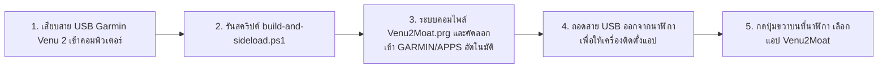
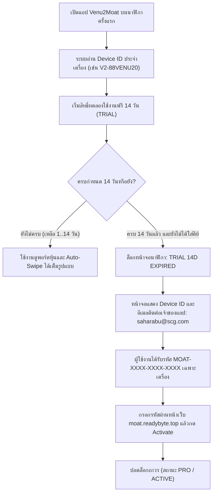

# คู่มือการใช้งานระบบ Venu2Moat อย่างละเอียด (User, Watch & Admin Manual)

เอกสารฉบับนี้เป็นคู่มือการใช้งานฉบับสมบูรณ์สำหรับระบบ **Venu2Moat v2.0** ครอบคลุมทั้งฝั่งผู้ใช้งานบนนาฬิกา **Garmin Venu 2**, หน้าเว็บ **Web Companion (`https://moat.readybyte.top`)**, และหน้าผู้ดูแลระบบ **Admin Licensing Portal (`https://admin-moat.readybyte.top`)**

---

## สารบัญ (Table of Contents)
1. [ภาพรวมระบบและ URL เข้าใช้งาน](#1-ภาพรวมระบบและ-url-เข้าใช้งาน)
2. [คู่มือการติดตั้งแอปลงนาฬิกา Garmin Venu 2 (USB MTP Sideload)](#2-คู่มือการติดตั้งแอปลงนาฬิกา-garmin-venu-2-usb-mtp-sideload)
3. [คู่มือการใช้งานแอปบนนาฬิกา Garmin Venu 2](#3-คู่มือการใช้งานแอปบนนาฬิกา-garmin-venu-2)
4. [คู่มือการตั้งค่า Auto-Swipe & Always-On Screen ผ่านเว็บ](#4-คู่มือการตั้งค่า-auto-swipe--always-on-screen-ผ่านเว็บ)
5. [คู่มือการจัดการพอร์ตหุ้น, ราคาเป้าหมาย (Alert) และ WebMemo](#5-คู่มือการจัดการพอร์ตหุ้น-ราคาเป้าหมาย-alert-และ-webmemo)
6. [คู่มือระบบ Trial 14 วัน และการปลดล็อก Paid Version (`saharabu@scg.com`)](#6-คู่มือระบบ-trial-14-วัน-และการปลดล็อก-paid-version-saharabuscgcom)
7. [คู่มือผู้ดูแลระบบ Admin Licensing Portal (`https://admin-moat.readybyte.top`)](#7-คู่มือผู้ดูแลระบบ-admin-licensing-portal-httpsadmin-moatreadybytetop)

---

## 1. ภาพรวมระบบและ URL เข้าใช้งาน

| ระบบ | URL / ช่องทางเข้าถึง | รายละเอียดหน้าที่ |
| :--- | :--- | :--- |
| **Web Companion App** | [`https://moat.readybyte.top`](https://moat.readybyte.top) | จัดการพอร์ตหุ้น, จดบันทึก WebMemo, ตั้งค่า Auto-Swipe / Always-On, จำลองหน้าจอนาฬิกา 416×416 และกรอกคีย์ปลดล็อกเครื่อง |
| **Admin Licensing Portal** | [`https://admin-moat.readybyte.top`](https://admin-moat.readybyte.top) | ระบบหลังบ้านเฉพาะเจ้าของแอป (`saharabu@scg.com`) สำหรับสร้าง Activation Key ราย `Device ID` และจัดการสถานะ Trial 14 วัน |
| **Garmin Watch API** | `https://moat.readybyte.top/api/watch?key=VENU2-88` | Endpoint JSON ขนาดกะทัดรัด (`<12KB`) ที่นาฬิกา Garmin Venu 2 ดึงผ่าน Bluetooth / Wi-Fi |
| **Garmin Binary (`.prg`)** | `dist/Venu2Moat.prg` | ไฟล์แอปพลิเคชัน Connect IQ สำหรับติดตั้งลงใน `Internal Storage\GARMIN\APPS\` ของนาฬิกา |

---

## 2. คู่มือการติดตั้งแอปลงนาฬิกา Garmin Venu 2 (USB MTP Sideload)



### ขั้นตอนแบบอัตโนมัติ (แนะนำ)
1. เสียบสาย USB เชื่อมต่อนาฬิกา **Garmin Venu 2** เข้ากับคอมพิวเตอร์ (โหมด MTP)
2. เปิด PowerShell ที่โฟลเดอร์โปรเจกต์ `D:\all-workspace\garmin-venu2` แล้วรันคำสั่ง:
   ```powershell
   npm run build:watch
   # หรือ
   powershell -NoProfile -ExecutionPolicy Bypass -File .\build-and-sideload.ps1
   ```
3. สคริปต์จะทำการคอมไพล์ซอร์สโค้ด Monkey C เป็นไฟล์ `dist\Venu2Moat.prg` และส่งไฟล์เข้า `Garmin Venu 2\Internal Storage\GARMIN\APPS\Venu2Moat.prg` โดยอัตโนมัติ
4. **สำคัญ:** ถอดสาย USB ออกจากนาฬิกา เพื่อให้ระบบปฏิบัติการของ Garmin ทำการ Verify และติดตั้งไฟล์ `.prg` เข้าสู่เมนูแอป

### ขั้นตอนแบบคัดลอกไฟล์ด้วยตนเอง (Manual Drag & Drop)
1. เปิด **This PC** ใน Windows Explorer -> เข้าไปที่ **Venu 2** -> **Internal Storage** -> **GARMIN** -> **APPS**
2. คัดลอกไฟล์ `dist\Venu2Moat.prg` ไปวางในโฟลเดอร์ `APPS`
3. ถอดสาย USB ออกจากนาฬิกา แล้วเปิดแอป **Venu2Moat** จากรายการแอปบนนาฬิกา

---

## 3. คู่มือการใช้งานแอปบนนาฬิกา Garmin Venu 2

หน้าจอของ Garmin Venu 2 มีความละเอียด **416×416 พิกเซล (Round AMOLED)** โดยมีการควบคุมดังนี้:

| การกระทำบนนาฬิกา | ตำแหน่ง / ปุ่ม | ผลลัพธ์การทำงาน |
| :--- | :--- | :--- |
| **กดปุ่มขวาบน (Select Button)** | ปุ่มกายภาพด้านขวาบน | สลับการแสดงผลกำไร/ขาดทุนระหว่าง **DAY P&L (รายวัน)** และ **TOTAL RETURN (รวมทั้งหมด)** (หรือกดเพื่อตรวจสอบสิทธิ์ใหม่หากอยู่ในหน้าจอ Trial Expired) |
| **กดค้างปุ่มขวาล่าง (Menu / Back)** | ปุ่มกายภาพด้านขวาล่าง (กดค้าง) | สั่งดึงข้อมูลพอร์ตและสถานะ License ล่าสุดจากเซิร์ฟเวอร์ (`fetchRemote()`) ทันที |
| **ปัดซ้าย / ปัดขวา (`SWIPE_LEFT` / `RIGHT`)** | หน้าจอสัมผัส | สลับไปยังพอร์ตโฟลิโอก่อนหน้า / ถัดไป (เช่น `US Wide Moat` ⇄ `Thai Dividend` ⇄ `Watchlist`) |
| **ปัดขึ้น / ปัดลง (`SWIPE_UP` / `DOWN`)** | หน้าจอสัมผัส | เลื่อนดูรายชื่อหุ้นขึ้น-ลงทีละแถวภายในพอร์ตปัจจุบัน |
| **แตะที่แถบเวลาด้านบนสุด (`y < 40px`)** | ขอบบนของหน้าจอ | เปิด / ปิดโหมด **Auto-Swipe** อย่างรวดเร็วจากหน้าปัดนาฬิกาโดยตรง |
| **แตะที่ชื่อหุ้นในตาราง (`y = 136..352px`)** | แถวรายการหุ้น | เปิดหน้า **Symbol Detail View** เพื่อดูกราฟ **14-Day Sparkline**, เส้น **SMA-20**, กรอบ **Bollinger Bands**, ราคาเป้าหมาย และบันทึก **WebMemo** |
| **แตะในหน้า Symbol Detail View** | หน้าจอรายละเอียดหุ้น | เปิด / ปิดเส้นอินดิเคเตอร์ **SMA-20 / Bollinger Overlay** |

### สัญลักษณ์สถานะบนแถบด้านบนสุดของหน้าปัด (`Top Status Bar`)
- **`14:30 · 5s · AON · 14d`** หรือ **`14:30 · 5s · PRO`**
  - **`5s`**: เปิดโหมด Auto-Swipe เลื่อนหน้าหุ้นอัตโนมัติทุกๆ 5 วินาที (เปลี่ยนตามเวลาที่ตั้งจากหน้าเว็บ)
  - **`AON`**: เปิดโหมด Always-On Display (หน้าจอไม่ดับขณะเปิดแอป)
  - **`14d`**: จำนวนวันที่เหลือของช่วงทดลองใช้ฟรี (Free Trial 14 วัน)
  - **`PRO`**: เครื่องนี้ได้รับการ Activate ด้วยคีย์ถาวรเรียบร้อยแล้ว

### สัญลักษณ์จุดสีแจ้งเตือนหน้าชื่อหุ้น (`Alert Dot`)
- 🟢 **จุดสีเขียวมรกต (`TARGET_HIT`)**: ราคาตลาดปัจจุบันทะลุถึงเป้าหมาย (`ABOVE Target`) ที่ตั้งไว้แล้ว
- 🔴 **จุดสีแดง (`STOP_BREACH`)**: ราคาตลาดลดลงต่ำกว่าจุดเฝ้าระวัง (`BELOW Stop/Target`) ที่ตั้งไว้

---

## 4. คู่มือการตั้งค่า Auto-Swipe & Always-On Screen ผ่านเว็บ

ผู้ใช้งานสามารถปรับพฤติกรรมหน้าจอนาฬิกาได้จากหน้าเว็บ [`https://moat.readybyte.top`](https://moat.readybyte.top) ในส่วนการ์ด **"Watch Display & License Settings"** ด้านซ้ายมือ:

1. **Auto-Swipe Next Screen (`เปิด/ปิด` + `เวลาวินาที`)**:
   - เมื่อเปิดสวิตช์ **Auto-Swipe Next Screen** นาฬิกาจะเลื่อนดูหุ้นทีละหน้า (หน้าละ 4 ตัว เช่น หน้า `1/2` -> `2/2`) และเมื่อครบทุกหน้าในพอร์ตนั้น จะสลับไปยังพอร์ตถัดไปให้อัตโนมัติวนไปเรื่อยๆ โดยไม่ต้องใช้มือปัดจอ
   - **ค่าเริ่มต้น (Default):** `5s` (5 วินาที)
   - **ตั้งค่าเวลาเองได้ (Custom Seconds):** กดปุ่มลัด `3s`, `5s`, `10s`, `15s` หรือพิมพ์ตัวเลขวินาทีที่ต้องการ (`2` ถึง `120` วินาที) ลงในช่องตัวเลขได้เลย
2. **Always-On Screen (`ไม่บังคับเปิด`)**:
   - ค่าเริ่มต้นจะ **ปิด (`OFF`)** เพื่อประหยัดแบตเตอรี่
   - หากต้องการวางนาฬิกาหรือเปิดแอปดูพอร์ตแบบไม่ให้หน้าจอดับ ให้เปิดสวิตช์ **Always-On Screen (Keep Awake)** แล้วกดปุ่ม **Save & Sync to Watch**

---

## 5. คู่มือการจัดการพอร์ตหุ้น, ราคาเป้าหมาย (Alert) และ WebMemo

บนหน้าเว็บ [`https://moat.readybyte.top`](https://moat.readybyte.top):
1. **การเปลี่ยนสกุลเงินหลัก (`THB ฿` / `USD $`)**:
   - กดปุ่มสกุลเงินมุมขวาบน ระบบจะคำนวณมูลค่าพอร์ตรวม (`Total Net Worth`) และกำไร/ขาดทุน (`Day P&L` / `Total Return`) ด้วยอัตราแลกเปลี่ยน `USD/THB` แบบเรียลไทม์จาก Yahoo Finance
2. **การเพิ่ม/ลบพอร์ตโฟลิโอ (`+ New Portfolio`)**:
   - แยกหมวดหมู่พอร์ตได้อิสระ เช่น พอร์ตหุ้นเติบโตสหรัฐฯ, พอร์ตหุ้นปันผลไทย (`.BK`), หรือรายการเฝ้าดู (`Watchlist` โดยใส่จำนวนหุ้น `Shares = 0`)
3. **การเพิ่มหุ้นและตั้งค่า WebMemo**:
   - พิมพ์ชื่อย่อหุ้น เช่น `NVDA`, `MSFT`, `ADVANC.BK`, `DELTA.BK`, `BTC-USD`
   - ระบุจำนวนหุ้น (`Shares`), ต้นทุนเฉลี่ย (`Avg Cost`), ราคาเป้าหมาย (`Target Price`), เงื่อนไขแจ้งเตือน (`ABOVE` หรือ `BELOW`) และข้อความเตือนความจำในช่อง **WebMemo** (เช่น `"Wide moat AI GPU leader, hold for FY27"`)
   - กด **Save & Sync** ข้อมูลจะพร้อมให้แอปบนนาฬิกาดึงไปแสดงผลทันที

---

## 6. คู่มือระบบ Trial 14 วัน และการปลดล็อก Paid Version (`saharabu@scg.com`)



### เมื่อครบกำหนดทดลองใช้ 14 วัน (`TRIAL 14D EXPIRED`)
- หน้าจอนาฬิกาและตัวจำลองบนเว็บจะเปลี่ยนเป็นหน้าจอล็อกสีแดงเข้ม แสดงข้อความ:
  - **`TRIAL 14D EXPIRED — Activation Required`**
  - **`ID: V2-XXXXXXXX`** (รหัสประจำเครื่องนาฬิกาของคุณ)
  - **`Contact App Owner (Paid): saharabu@scg.com`**
- **วิธีปลดล็อกใช้งานถาวร:**
  1. แจ้งรหัส **`Device ID`** ที่แสดงบนหน้าจอนาฬิกาไปยังเจ้าของแอปที่อีเมล **`saharabu@scg.com`**
  2. เมื่อได้รับรหัส **Activation Key** (รูปแบบ `MOAT-XXXX-XXXX-XXXX` ซึ่งผูกเฉพาะกับ `Device ID` ของคุณเท่านั้น)
  3. เปิดเว็บ [`https://moat.readybyte.top`](https://moat.readybyte.top) -> ไปที่ช่อง **Activation Key** ด้านซ้าย -> วางรหัสคีย์แล้วกดปุ่ม **Activate**
  4. บนนาฬิกา กดปุ่มขวาบน (**SELECT**) เพื่อซิงค์สถานะ หน้าจอล็อกจะปลดล็อกทันทีและแสดงสถานะ **`PRO`**

---

## 7. คู่มือผู้ดูแลระบบ Admin Licensing Portal (`https://admin-moat.readybyte.top`)

หน้า Admin Portal แยกเป็น Subdomain เฉพาะที่ [`https://admin-moat.readybyte.top`](https://admin-moat.readybyte.top) สำหรับเจ้าของระบบ (**`saharabu@scg.com`**) เท่านั้น

### 7.1 การเข้าสู่ระบบ (Cloudflare Zero Trust + 6-Digit OTP Gate)
1. เปิด [`https://admin-moat.readybyte.top`](https://admin-moat.readybyte.top)
2. หากเชื่อมต่อผ่าน **Cloudflare Access Zero Trust Policy** ที่ล็อกอินด้วยอีเมล `saharabu@scg.com` ระบบจะตรวจสอบ Header `Cf-Access-Authenticated-User-Email` และอนุมัติเข้าสู่ระบบให้อัตโนมัติ
3. หรือเข้าสู่ระบบผ่าน **Admin OTP Gate**:
   - ระบุอีเมลผู้ดูแลระบบ: `saharabu@scg.com`
   - กดปุ่ม **Request 6-Digit OTP** (หรือใช้รหัส Admin Passkey `SCG-888888`) แล้วกด **Verify & Sign In**

### 7.2 การออกรหัส Activation Key รายเครื่อง (`Per-Device Key Generator`)
1. ในส่วน **Generate Activation Key by Device ID**:
   - กรอก **`Device ID`** ของลูกค้า (เช่น `V2-88VENU20`)
   - กรอกชื่อกำกับเครื่อง / ชื่อลูกค้าในช่อง **Customer Label / Note**
   - เลือกได้ว่าจะสร้างเฉพาะรหัสคีย์เพื่อส่งให้ลูกค้ากรอกเอง (**Generate Key**) หรือสั่งปลดล็อกเครื่องให้ลูกค้าทันทีจากฝั่งแอดมิน (**Generate & Auto-Activate**)
2. ระบบใช้ฟังก์ชันการเข้ารหัส `HMAC-SHA256(deviceId, secret)` สร้างรหัสรูปแบบ `MOAT-XXXX-XXXX-XXXX` ที่ผูกกับ `Device ID` นั้นโดยเฉพาะ (ไม่สามารถนำคีย์ของเครื่องหนึ่งไปใช้กับอีกเครื่องได้)

### 7.3 เครื่องมือบริหารจัดการสถานะเครื่องและทดสอบ SDLC
ในตาราง **Registered Garmin Venu 2 Devices** แอดมินสามารถกดปุ่มควบคุมรายเครื่องได้ทันที:
- **`Copy Key`**: คัดลอก Activation Key ของเครื่องนั้นส่งให้ลูกค้า
- **`Activate`**: ปลดล็อกเครื่องเป็นสถานะ `ACTIVE (Paid)` ทันที
- **`Expire 14d`**: บังคับให้สิทธิ์ทดลองใช้หมดอายุทันที (ใช้ทดสอบหน้าจอล็อก `TRIAL 14D EXPIRED` บนนาฬิกา)
- **`+14d`**: ต่ออายุเวลาทดลองใช้เพิ่มให้อีก 14 วัน
- **`Reset 14d`**: รีเซ็ตเวลานับถอยหลัง Trial 14 วันใหม่ตั้งแต่ต้น
