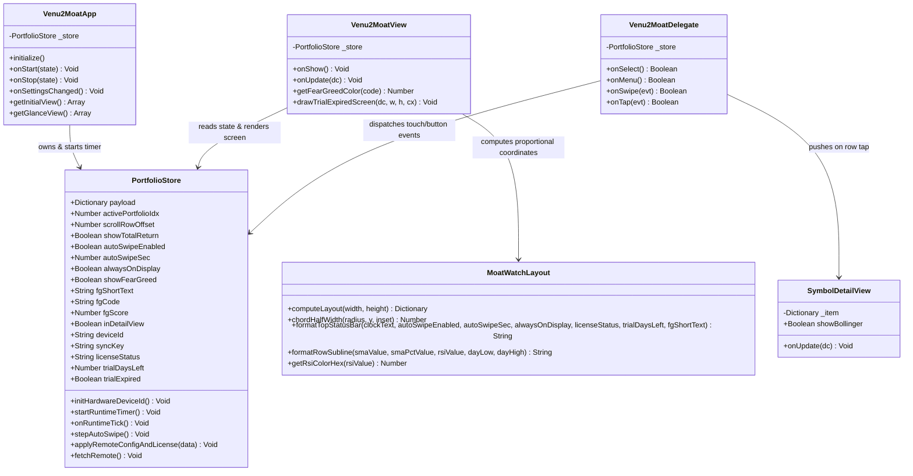

# MoatWatch — App Design & Multi-Device Garmin Round Display (`260×260`–`454×454`) UI Specification

เอกสารฉบับนี้อธิบายการออกแบบสถาปัตยกรรมหน้าจอ (UI/UX Blueprint), ระบบคำนวณพิกัดตามสัดส่วนหน้าจอกลม (**Proportional Layout Engine — `MoatWatchLayout.mc`**) สำหรับนาฬิกา **Garmin ทั้ง 20 รุ่น (2024–2026)**, ระบบสี AMOLED True Black, ป้ายสถานะ **Daily US Market Fear & Greed Index (`FG:xxG` / `FG:xxEF`)**, และการออกแบบคลาสในภาษา **Monkey C (`minApiLevel 3.2.0`)**

---

## 1. ข้อมูลจำเพาะทางฮาร์ดแวร์ของนาฬิกา Garmin ทั้ง 20 รุ่นที่รองรับ

| พารามิเตอร์ฮาร์ดแวร์ | ค่ามาตรฐานของตระกูล Garmin (2024–2026) | แนวทางการออกแบบใน MoatWatch |
| :--- | :--- | :--- |
| **ความละเอียดหน้าจอ** | **`260×260` ถึง `454×454` พิกเซล** (ทรงกลม Round Display) | ใช้โมดูล `MoatWatchLayout.computeLayout(w, h)` คำนวณระยะขอบโค้งตามคณิตศาสตร์วงกลม (`Chord Safe Width`) ไม่ให้ข้อความตกขอบในทุกขนาดหน้าจอ |
| **ชนิดหน้าจอ** | **AMOLED** (Venu 2/3, Forerunner 165/265/965, fēnix 8, epix Pro, vívoactive 5, Approach S70) และ **Solar MIP** (fēnix 8 Solar, Enduro 3) | ใช้พื้นหลัง **True Void Black (`0x000000`)** เพื่อประหยัดพลังงานแบตเตอรี่สูงสุดและให้อัตราส่วนคอนทราสต์คมชัดทั้งบนจอ AMOLED และ MIP |
| **หน่วยความจำ HTTP JSON** | จำกัดการแปลง JSON ในหน่วยความจำ (`Communications.makeWebRequest`) | ออกแบบ Compact Watch Payload (`/api/watch`) ใช้คีย์ย่อ (`p`, `s`, `cfg`, `lic`, `tot`, `fg`) ให้ขนาดเพย์โหลดรวมต่ำกว่า `4 KB` |
| **ปุ่มกดและอินพุต** | 2 ถึง 5 ปุ่มกายภาพ + หน้าจอสัมผัส (`Swipe`, `Tap`) | รองรับทั้งการกดปุ่ม, การปัดจอ 4 ทิศทาง, การแตะแถวหุ้น, และระบบ **Auto-Swipe** แบบไร้สัมผัส |

---

## 2. ผังพิกัดหน้าจอนาฬิกา Garmin (Coordinate-Level Screen Blueprints — อ้างอิงสเกล 416×416)

### 2.1 หน้าจอหลัก: Portfolio, US Fear & Greed Badge (`FG:xx`) & Holdings View (`Venu2MoatView.mc`)

```
                    ╭───────────────────────────────╮
                 ╭──╯  14:30 · FG:64G · 5s · PRO    ╰──╮   [y = 14px]  Clock + Colored FG:xx Badge + Auto-Swipe + PRO/Trial
              ╭──╯       < US Wide Moat 1/2 >          ╰──╮ [y = 40px]  Portfolio Title + Page Indicator
            ╭─╯               ฿1,482,910                  ╰─╮ [y = 60px]  Portfolio Net Value (FONT_MEDIUM)
           ╭╯         DAY: +฿18,420 (+1.25%)                ╰╮ [y = 98px]  Day P&L / Total Return Toggle
          ╭╯  ─────────────────────────────────────────────  ╰╮ [y = 122px] Divider Line
          │   ┌───────────────────────────────────────────┐   │
          │   │ ● NVDA  e-28/05/26   $138.60     +2.82%   │   │ [y = 132px] Row 1 (Line 1: Symbol, Earnings, Price, %Chg)
          │   │   SMA:132(+4.7%) RSI:61.2 L:135 H:139     │   │             Row 1 (Line 2: SMA20, RSI14 Zone, Day Low/High)
          │   └───────────────────────────────────────────┘   │
          │   ┌───────────────────────────────────────────┐   │
          │   │   MSFT  e-24/07/26   $428.50     +1.04%   │   │ [y = 188px] Row 2
          │   │   SMA:420(+2.0%) RSI:54.8 L:424 H:430     │   │
          │   └───────────────────────────────────────────┘   │
          │   ┌───────────────────────────────────────────┐   │
          │   │   GOOGL              $181.40     +1.28%   │   │ [y = 244px] Row 3
          │   │   SMA:176(+3.1%) RSI:58.0 L:179 H:182     │   │
          │   └───────────────────────────────────────────┘   │
          │   ┌───────────────────────────────────────────┐   │
          │   │   BRK-B              $454.80     +0.62%   │   │ [y = 300px] Row 4
          │   │   SMA:449(+1.3%) RSI:52.1 L:451 H:456     │   │
          │   └───────────────────────────────────────────┘   │
           ╰╮                                               ╭╯
            ╰─╮                  ●  ○  ○                  ╭─╯ [y = 390px] Portfolio Pagination Dots
              ╰──╮                                     ╭──╯
                 ╰──╮                               ╭──╯
                    ╰───────────────────────────────╯
```

### 2.2 หน้าจอรายละเอียดหุ้น: Symbol Detail + Sparkline + WebMemo (`SymbolDetailView.mc`)

```
                    ╭───────────────────────────────╮
                 ╭──╯             NVDA              ╰──╮   [y = 24px]  Symbol Ticker (FONT_SMALL)
              ╭──╯        $138.60 (+2.82%)             ╰──╮ [y = 56px]  Live Price & Change %
            ╭─╯            [TARGET_HIT]                   ╰─╮ [y = 80px]  Alert Status Pill (Emerald/Rose/Amber)
           ╭╯  ┌─────────────────────────────────────────┐  ╰╮
          ╭╯   │  ╭──╮        ╭───╮        ╭──────────   │   ╰╮ [y = 108..204px] 14-Day Sparkline (3px stroke)
          │    │ ─╯  ╰────────╯   ╰────────╯  (SMA-20)   │    │                  + Cyan SMA-20 Overlay (1px)
          ╰╮   └─────────────────────────────────────────┘   ╭╯
           ╰╮      Hold: 45.0 @ $92.5 (+49.8%)              ╭╯ [y = 220px] Position Shares, Avg Cost & Total P&L%
            ╰─╮               WEBMEMO                     ╭─╯ [y = 254px] WebMemo Header (Cyan 0x06B6D4)
              ╰──╮  "AI datacenter monopoly; trim 10%  ╭──╯   [y = 280px] Auto-wrapped Thesis Note (fitTextToArea)
                 ╰──╮     if PE exceeds 45x"        ╭──╯
                    ╰───────────────────────────────╯
```

### 2.3 หน้าจอล็อกเมื่อหมดเวลาทดลองใช้ 14 วัน (`drawTrialExpiredScreen` ใน `Venu2MoatView.mc`)

```
                    ╭═══════════════════════════════╮
                 ╭══╯   ┌───────────────────────┐   ╰══╮   [Outer Ring] Rose Alert Border (0xF43F5E, 3px)
              ╭══╯      │   TRIAL 14D EXPIRED   │      ╰══╮ [y = 56px]  Rose Badge Pill (0x3B0A18 fill)
            ╭═╯         └───────────────────────┘         ╰═╮
           ╭║              Activation Required              ║╮ [y = 102px] White Header (FONT_SMALL)
          ╭║     ┌─────────────────────────────────────┐     ║╮
          ║      │          ID: V2-88VENU20            │      ║ [y = 142px] Device ID Box (Amber 0xF59E0B)
          ║      └─────────────────────────────────────┘      ║
          ║            Contact App Owner (Paid):              ║ [y = 198px] Subtitle (Slate 0x94A3B8)
          ╰║     ┌─────────────────────────────────────┐     ║╯
           ╰║    │       saharat.bun@icloud.com        │    ║╯ [y = 230px] Owner Contact Pill (Cyan 0x06B6D4)
            ╰═╮  └─────────────────────────────────────┘  ╭═╯
              ╰══╮      Activate via Web Settings      ╭══╯   [y = 292px] Action Hint
                 ╭══╮    Press SELECT to Verify     ╭══╯      [y = 322px] Re-sync Trigger Hint (Emerald)
                    ╰═══════════════════════════════╯
```

---

## 3. ระบบสี AMOLED & โซนสีของดัชนี US Fear & Greed (`Color & Sentiment Zone System`)

### 3.1 ตารางโซนสีของ Daily US Market Fear & Greed Index (`FG:xx<Code>`)

| ช่วงคะแนน (0–100) | ตัวย่อบนนาฬิกา (`shortText`) | ความหมาย (`rating`) | Web Hex | Monkey C Hex |
| :--- | :--- | :--- | :--- | :--- |
| **`0 – 24`** | **`FG:xxEF`** (เช่น `FG:18EF`) | **Extreme Fear (กลัวสุดขีด)** | `#F43F5E` | `0xF43F5E` (Crimson Rose) |
| **`25 – 44`** | **`FG:xxF`** (เช่น `FG:38F`) | **Fear (กลัว)** | `#FB923C` | `0xFB923C` (Orange) |
| **`45 – 55`** | **`FG:xxN`** (เช่น `FG:50N`) | **Neutral (เป็นกลาง)** | `#94A3B8` | `0x94A3B8` (Slate) |
| **`56 – 74`** | **`FG:xxG`** (เช่น `FG:64G`) | **Greed (โลภ/คึกคัก)** | `#10B981` | `0x10B981` (Profit Emerald) |
| **`75 – 100`** | **`FG:xxEG`** (เช่น `FG:82EG`) | **Extreme Greed (โลภสุดขีด)** | `#06B6D4` | `0x06B6D4` (Moat Cyan) |

### 3.2 ระบบสีหลักของแอป (Core Design Tokens)

| Token Name | Hex Code | Monkey C Hex | การนำไปใช้งาน |
| :--- | :--- | :--- | :--- |
| **Void Black** | `#000000` / `#050608` | `Graphics.COLOR_BLACK` | พื้นหลังหลักของหน้าปัดนาฬิกา (ปิดเม็ดพิกเซล AMOLED เพื่อประหยัดพลังงาน) |
| **Row Surface Tray** | `#0D131C` | `0x0D131C` | พื้นหลังแถวรายการหุ้นทรงแคปซูลโค้งมน |
| **Alabaster White** | `#FFFFFF` | `Graphics.COLOR_WHITE` | มูลค่าพอร์ตสุทธิ, ชื่อย่อหุ้น (`sym`), และข้อความหลัก |
| **Moat Cyan** | `#06B6D4` | `0x06B6D4` | ชื่อพอร์ตโฟลิโอ, เส้นค่าเฉลี่ย `SMA-20`, โซน `Extreme Greed (EG)`, และอีเมลเจ้าของระบบ |
| **Profit Emerald** | `#10B981` | `0x10B981` | กำไรเป็นบวก (`+P&L`), โซน `Greed (G)`, จุดแจ้งเตือน `TARGET_HIT`, และสถานะ `ACTIVE` |
| **Loss Crimson Rose** | `#F43F5E` | `0xF43F5E` | ขาดทุนติดลบ (`-P&L`), โซน `Extreme Fear (EF)`, จุดแจ้งเตือน `STOP_BREACH`, และกรอบล็อก `TRIAL 14D EXPIRED` |
| **Warning Amber** | `#F59E0B` | `0xF59E0B` | วันประกาศงบ `e-dd/mm/yy`, แจ้งเตือน `NEAR_TARGET`, และป้ายแสดงรหัส `Device ID` |

---

## 4. โครงสร้างคลาสของแอปนาฬิกา Garmin Connect IQ (`Class Diagram`)


