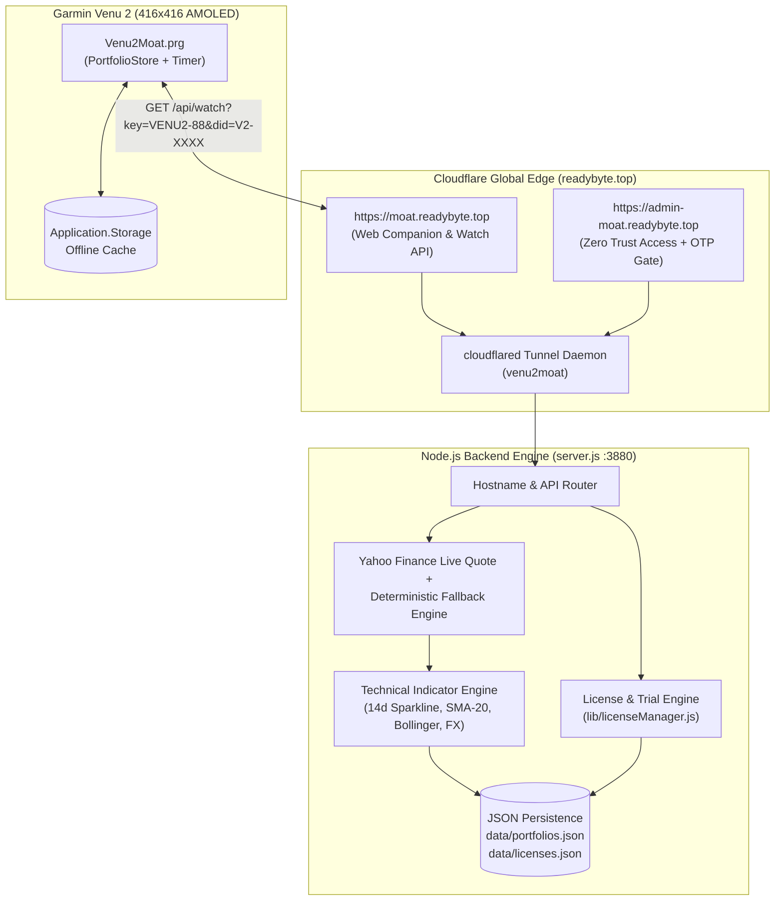
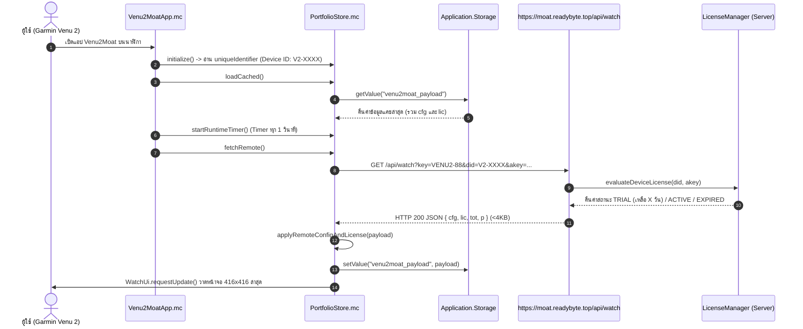
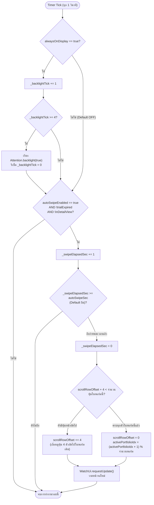
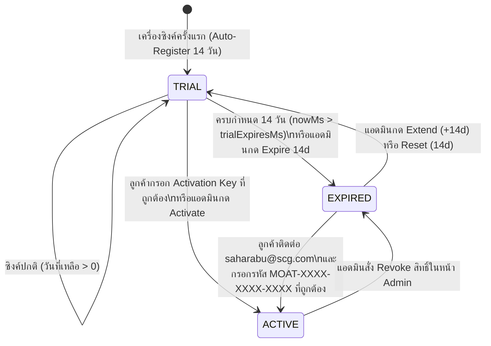
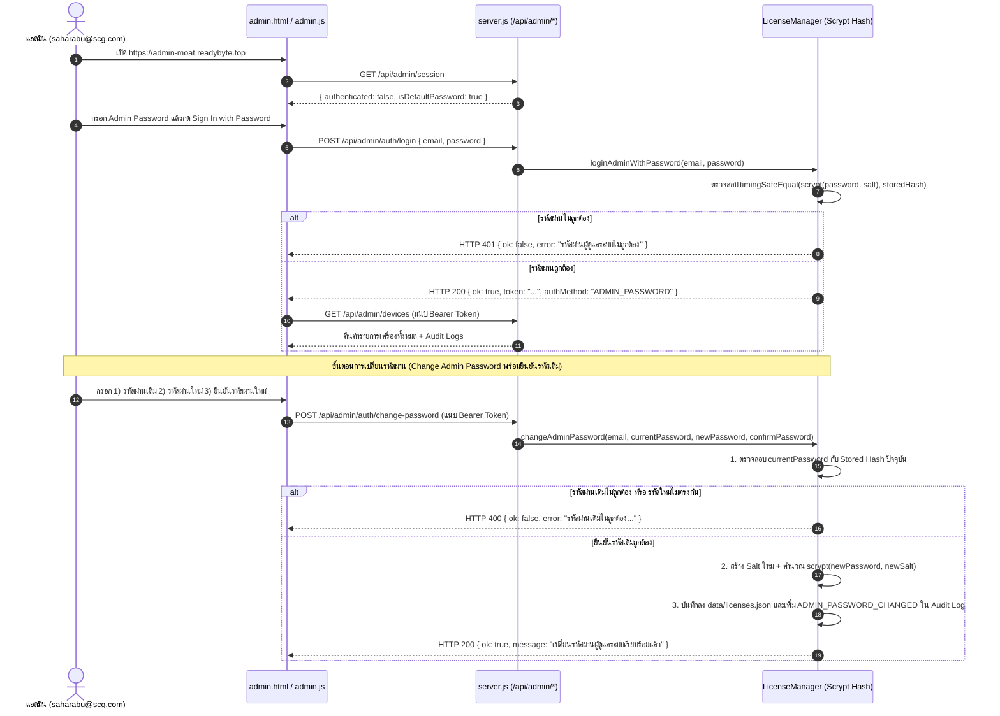
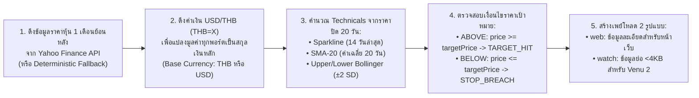

# Venu2Moat — App Flow & Core Logic Flow Specification

เอกสารฉบับนี้อธิบายลำดับการทำงานของระบบ (**App Flow**) และตรรกะการตัดสินใจเชิงลึก (**Logic Flow**) ทุกโมดูล ตั้งแต่การซิงค์ข้อมูลระหว่างเว็บกับนาฬิกา, ระบบ Auto-Swipe & Always-On Timer, อัลกอริทึมตรวจสอบสิทธิ์ Trial 14 วัน / Activation Key (`HMAC-SHA256`), ไปจนถึงการคำนวณอินดิเคเตอร์ทางเทคนิค (`SMA-20` & `Bollinger Bands`)

---

## 1. สถาปัตยกรรมภาพรวมและการไหลของข้อมูล (End-to-End Architecture Flow)



---

## 2. App Flow: การเริ่มต้นแอปบนนาฬิกาและการซิงค์ข้อมูล (Watch Startup & Sync Sequence)

เมื่อผู้ใช้เปิดแอป **Venu2Moat** บนนาฬิกา Garmin Venu 2 แอปจะแสดงข้อมูลจากแคชในเครื่องทันที (`0ms latency`) ก่อนดึงข้อมูลสดจากเซิร์ฟเวอร์ในพื้นหลัง:



---

## 3. Logic Flow: ระบบ Auto-Swipe หน้าจอหุ้น & Always-On Backlight (`PortfolioStore.mc`)

ทุกๆ **1 วินาที** (`_runtimeTimer.start(method(:onRuntimeTick), 1000, true)`) ระบบใน [`PortfolioStore.onRuntimeTick`](../garmin-venu2-app/source/PortfolioStore.mc) จะประมวลผลตรรกะ 2 ส่วนพร้อมกัน:

1. **Always-On Screen Logic (`alwaysOnDisplay`):**
   - หากผู้ใช้เปิด `alwaysOnDisplay = true` (ไม่ได้บังคับเปิด; ค่าเริ่มต้นคือ `false`)
   - ทุกๆ 4 วินาที (`_backlightTick >= 4`) ระบบจะเรียก `Attention.backlight(true)` เพื่อยืดเวลาไฟหน้าจอ AMOLED ไม่ให้ดับขณะเปิดดูพอร์ต
2. **Auto-Swipe Pagination Logic (`autoSwipeEnabled`, `autoSwipeSec`):**
   - จะทำงานเมื่อ `autoSwipeEnabled == true` **และ** ไม่ได้ติดหน้าจอล็อก (`!trialExpired`) **และ** ไม่ได้เปิดหน้ากราฟรายตัวค้างไว้ (`!inDetailView`)
   - เมื่อนับเวลาครบ `autoSwipeSec` วินาที (ค่าเริ่มต้น `5` วินาที หรือตามที่ตั้งจากเว็บ `2..120` วินาที):
     - ถ้ารายการหุ้นในพอร์ตปัจจุบันยังมีหน้าถัดไป (`scrollRowOffset + 4 < itemCount`) -> เลื่อนลง 4 แถว (`scrollRowOffset += 4`) เพื่อแสดงหุ้นชุดถัดไป (เช่น หน้า `1/2` -> `2/2`)
     - ถ้าแสดงครบทุกหน้าของพอร์ตปัจจุบันแล้ว -> รีเซ็ตแถวกลับไปหน้าแรก (`scrollRowOffset = 0`) แล้วสลับไปยังพอร์ตโฟลิโอถัดไป (`activePortfolioIdx = (activePortfolioIdx + 1) % list.size()`)
   - หากผู้ใช้สัมผัสหน้าจอหรือกดปุ่มใดๆ ระบบจะเรียก `resetSwipeTimer()` เพื่อเริ่มนับเวลาใหม่ทันที ไม่ให้หน้าจอเด้งเปลี่ยนหน้าจังหวะที่ผู้ใช้กำลังกดดู



---

## 4. Logic Flow: ระบบ 14-Day Free Trial & Per-Device Activation Key (`lib/licenseManager.js`)

### 4.1 State Machine ของสถานะเครื่อง (`Device License Lifecycle`)



### 4.2 อัลกอริทึมการสร้างและตรวจสอบ Activation Key ราย `Device ID`
ระบบป้องกันการใช้คีย์ข้ามเครื่องด้วยการผูก `Device ID` เข้ากับรหัสคีย์ผ่านอัลกอริทึม **HMAC-SHA256**:
1. **Normalization:** แปลง `deviceId` เป็นตัวพิมพ์ใหญ่และตัดอักขระพิเศษ (เช่น `V2-88VENU20`)
2. **HMAC Digest:** คำนวณ `HMAC_SHA256(secretKey, "VENU2MOAT_V2::" + normalizedDeviceId + "::saharabu@scg.com")`
3. **Base32 Readability Encoding:** แปลงค่าแฮชเป็นชุดตัวอักษรที่อ่านง่าย (ตัด `0/O/1/I` เพื่อไม่ให้สับสนเวลาพิมพ์) จำนวน 12 ตัวอักษร แล้วจัดรูปแบบเป็น:
   ```text
   MOAT-XXXX-XXXX-XXXX
   ```
   *(ตัวอย่าง: เครื่อง `V2-SDLC9901` จะได้คีย์เฉพาะเครื่องคือ `MOAT-RZA6-TADM-HLFV` เสมอ)*

---

## 5. Logic Flow: ระบบยืนยันตัวตนด้วย Admin Password และการเปลี่ยนรหัสผ่าน (`https://admin-moat.readybyte.top`)

หน้า Admin Portal ใช้การยืนยันตัวตนด้วย **Admin Password (เข้ารหัสด้วย `scrypt` + Random Salt)** สำหรับเจ้าของระบบ **`saharabu@scg.com`** และอนุญาตให้เปลี่ยนรหัสผ่านใหม่หลังล็อกอินโดยบังคับตรวจสอบรหัสผ่านเดิม (`Current Password`) ก่อนทุกครั้ง:



---

## 6. Logic Flow: การคำนวณมูลค่าพอร์ต, อัตราแลกเปลี่ยน และอินดิเคเตอร์เทคนิค (`server.js`)


