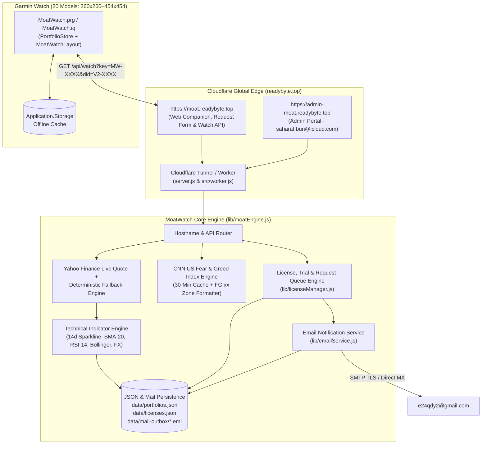
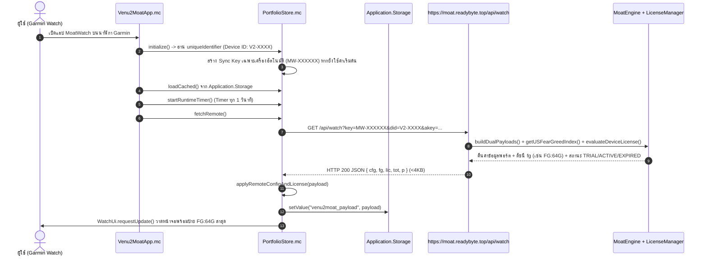
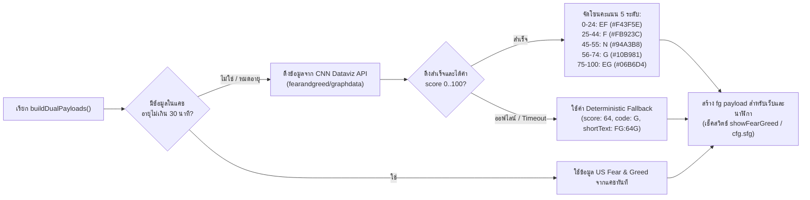
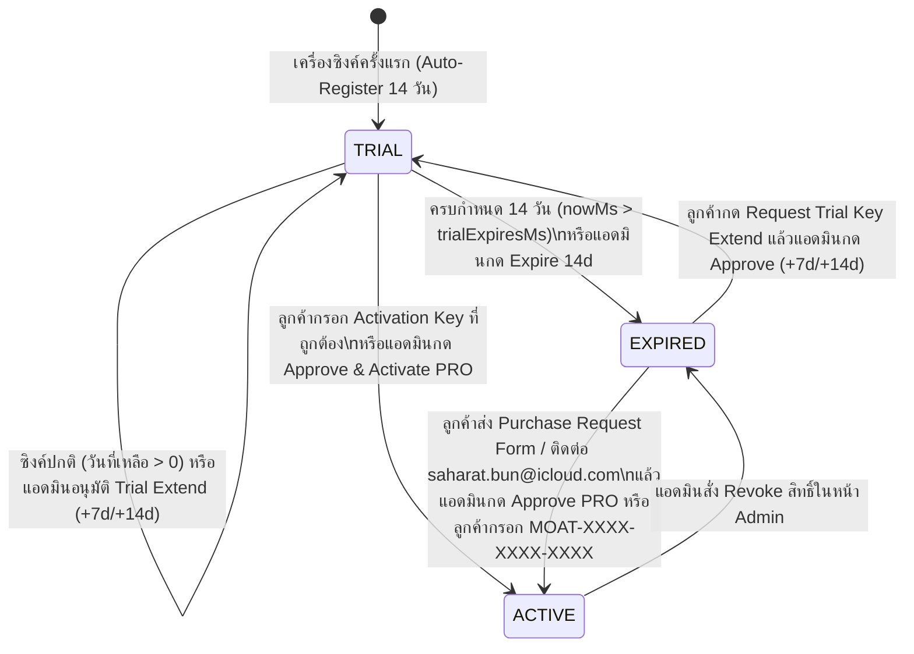
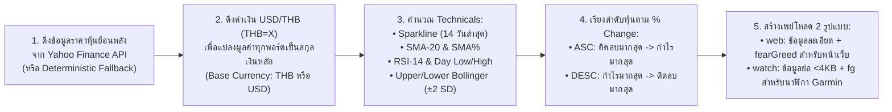

# MoatWatch — App Flow & Core Logic Flow Specification

เอกสารฉบับนี้อธิบายลำดับการทำงานของระบบ (**App Flow**) และตรรกะการตัดสินใจเชิงลึก (**Logic Flow**) ทุกโมดูล ตั้งแต่การซิงค์ข้อมูลระหว่างเว็บกับนาฬิกา Garmin ทั้ง 20 รุ่น, ระบบดึงค่าดัชนี **Daily US Market Fear & Greed Index (`FG:xxG` / `FG:xxEF`)**, ระบบ Auto-Swipe & Always-On Timer, ระบบแยกพอร์ตรายเครื่องอัตโนมัติ (Multi-User Auto-Device-ID), อัลกอริทึมตรวจสอบสิทธิ์ Trial 14 วัน / Activation Key (`HMAC-SHA256`), และระบบส่งอีเมลแจ้งเตือนไปยัง **`e24qdy2@gmail.com`**

---

## 1. สถาปัตยกรรมภาพรวมและการไหลของข้อมูล (End-to-End Architecture Flow)

---

## 2. App Flow: การเริ่มต้นแอปบนนาฬิกา Garmin และการซิงค์ข้อมูล (Watch Startup & Sync Sequence)

เมื่อผู้ใช้เปิดแอป **MoatWatch** บนนาฬิกา Garmin แอปจะอ่านรหัสฮาร์ดแวร์ประจำเครื่อง (`uniqueIdentifier`), สร้าง `Sync Key` เฉพาะเครื่องหากยังไม่ได้ตั้งค่า, แสดงข้อมูลจากแคชในเครื่องทันที (`0ms latency`), แล้วดึงข้อมูลสดพร้อมดัชนี `Fear & Greed` จากเซิร์ฟเวอร์ในพื้นหลัง:

---

## 3. Logic Flow: ระบบดึงและคำนวณ Daily US Market Fear & Greed Index (`lib/moatEngine.js`)

---

## 4. Logic Flow: ระบบ Auto-Swipe หน้าจอหุ้น & Always-On Backlight (`PortfolioStore.mc`)

ทุกๆ **1 วินาที** (`_runtimeTimer.start(method(:onRuntimeTick), 1000, true)`) ระบบใน [`PortfolioStore.onRuntimeTick`](../garmin-venu2-app/source/PortfolioStore.mc) จะประมวลผลตรรกะ 2 ส่วนพร้อมกัน:

1. **Always-On Screen Logic (`alwaysOnDisplay`):**
   - หากผู้ใช้เปิด `alwaysOnDisplay = true` ทุกๆ 4 วินาทีระบบจะเรียก `Attention.backlight(true)` เพื่อยืดเวลาไฟหน้าจอไม่ให้ดับขณะเปิดดูพอร์ต
2. **Auto-Swipe Pagination Logic (`autoSwipeEnabled`, `autoSwipeSec`):**
   - ทำงานเมื่อ `autoSwipeEnabled == true` **และ** ไม่ได้ติดหน้าจอล็อก (`!trialExpired`) **และ** ไม่ได้เปิดหน้ากราฟรายตัวค้างไว้ (`!inDetailView`)
   - เมื่อนับเวลาครบ `autoSwipeSec` วินาที (ค่าเริ่มต้น `5` วินาที หรือตามที่ตั้งจากเว็บ `2..120` วินาที):
     - ถ้าในพอร์ตปัจจุบันยังมีหุ้นหน้าถัดไป -> เลื่อนลง 4 แถว (`scrollRowOffset += 4`)
     - ถ้าแสดงครบทุกหน้าของพอร์ตปัจจุบันแล้ว -> รีเซ็ตแถวกลับไปหน้าแรก (`scrollRowOffset = 0`) แล้วสลับไปยังพอร์ตโฟลิโอถัดไป (`activePortfolioIdx = (activePortfolioIdx + 1) % list.size()`)

---

## 5. Logic Flow: ระบบ 14-Day Free Trial, Customer Request Queue & Per-Device Activation Key (`lib/licenseManager.js`)

---

## 6. Logic Flow: การคำนวณมูลค่าพอร์ต, อัตราแลกเปลี่ยน, อินดิเคเตอร์เทคนิค & Auto-Sort `% Change` (`lib/moatEngine.js`)

