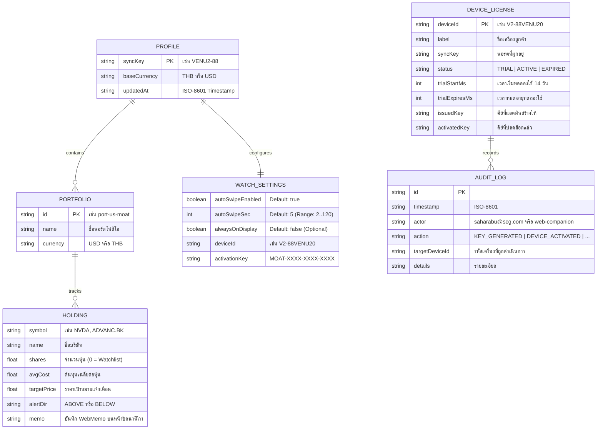

# Venu2Moat — API Reference, Data Models & SDLC Guide

เอกสารฉบับนี้รวบรวมโครงสร้างฐานข้อมูล (`Entity-Relationship Diagram`), รายละเอียด REST API ทุก Endpoint พร้อมตัวอย่าง JSON Payload, และขั้นตอนการทดสอบตามมาตรฐาน **SDLC (Software Development Life Cycle)**

---

## 1. โครงสร้างข้อมูล (Data Model & ER Diagram)

ระบบจัดเก็บข้อมูลในรูปแบบ JSON ที่อ่านและสำรองข้อมูลได้ง่าย (`data/portfolios.json` และ `data/licenses.json`):



---

## 2. รายละเอียด REST API Endpoints

### 2.1 Watch & Web Companion Endpoints (`https://moat.readybyte.top`)

| Method | Endpoint | คำอธิบาย |
| :--- | :--- | :--- |
| `GET` | `/api/watch?key=VENU2-88&did=V2-XXXX&akey=...` | คืนค่า Compact JSON (`<4KB`) สำหรับแอปบนนาฬิกา Garmin Venu 2 พร้อมการตั้งค่า `cfg` และสถานะไลเซนส์ `lic` |
| `GET` | `/api/portfolio?key=VENU2-88` | คืนค่าข้อมูลพอร์ตแบบเต็มสำหรับหน้าเว็บ Companion และ Watch Simulator |
| `PUT` / `POST` | `/api/portfolio` | บันทึกการแก้ไขพอร์ตหุ้น, WebMemo, สกุลเงินหลัก และการตั้งค่า `watchSettings` (`autoSwipeEnabled`, `autoSwipeSec`, `alwaysOnDisplay`) |
| `POST` | `/api/device/activate` | ตรวจสอบและปลดล็อก `deviceId` ด้วยรหัส `activationKey` (`MOAT-XXXX-XXXX-XXXX`) |
| `GET` | `/api/device/status?key=VENU2-88&did=V2-XXXX` | ตรวจสอบสถานะ Trial 14 วัน หรือสถานะการเปิดใช้งานของเครื่อง |
| `GET` | `/api/quote?symbol=NVDA` | ดึงราคาตลาดและอินดิเคเตอร์ของหุ้นรายตัวแบบเรียลไทม์ |

#### ตัวอย่าง Compact JSON จาก `GET /api/watch?key=VENU2-88&did=V2-88VENU20`
```json
{
  "k": "VENU2-88",
  "bc": "THB",
  "fx": 33.58,
  "ts": 1792505891,
  "cfg": {
    "asw": 1,
    "asec": 5,
    "aon": 0
  },
  "lic": {
    "did": "V2-88VENU20",
    "st": "TRIAL",
    "days": 14,
    "exp": 0,
    "own": "saharabu@scg.com"
  },
  "tot": {
    "val": 1482910,
    "dp": 18420,
    "dPct": 1.25,
    "tp": 312450,
    "tPct": 26.69
  },
  "p": [
    {
      "id": "us-moat",
      "n": "US Wide Moat",
      "val": 920400,
      "dp": 14200,
      "dPct": 1.57,
      "tp": 248900,
      "tPct": 37.06,
      "al": 1,
      "s": [
        {
          "s": "NVDA",
          "sym": "NVDA",
          "cur": "USD",
          "p": 138.6,
          "px": 138.6,
          "c": 2.82,
          "pct": 2.82,
          "sh": 45,
          "avg": 92.5,
          "pPct": 49.84,
          "tgt": 135,
          "alrt": "TARGET_HIT",
          "note": "AI GPU moat leader; hold core position",
          "spk": [128.4, 130.1, 133.5, 135.2, 138.6],
          "sma": 132.4,
          "ub": 140.2,
          "lb": 124.6
        }
      ]
    }
  ]
}
```

---

### 2.2 Admin Licensing Portal Endpoints (`https://admin-moat.readybyte.top`)

ทุก Endpoint ภายใต้ `/api/admin/*` บังคับตรวจสอบสิทธิ์ผู้ดูแลระบบ (`saharabu@scg.com`) ผ่าน Header `Authorization: Bearer <token>` หรือ `X-Admin-Token`:

| Method | Endpoint | คำอธิบาย |
| :--- | :--- | :--- |
| `GET` | `/api/admin/session` | ตรวจสอบสถานะการล็อกอินของแอดมิน และสถานะรหัสผ่าน (`isDefaultPassword`, `passwordUpdatedAt`) |
| `POST` | `/api/admin/auth/login` | ล็อกอินเข้าสู่ระบบผู้ดูแลด้วยรหัสผ่าน (`{ email: "saharabu@scg.com", password }`) เพื่อรับ Session Token |
| `POST` | `/api/admin/auth/change-password` | เปลี่ยนรหัสผ่านผู้ดูแลระบบหลังล็อกอิน โดยต้องส่ง `{ currentPassword, newPassword, confirmPassword }` เพื่อยืนยันรหัสผ่านเดิมก่อนเสมอ |
| `GET` | `/api/admin/devices` | ดึงรายชื่อเครื่อง Garmin Venu 2 ทั้งหมด, สถิติสรุป และ Audit Logs |
| `POST` | `/api/admin/devices/generate-key` | สร้างรหัส Activation Key (`MOAT-XXXX-XXXX-XXXX`) ผูกกับ `deviceId` |
| `POST` | `/api/admin/devices/update` | เปลี่ยนสถานะเครื่อง (`ACTIVATE`, `EXPIRE_TRIAL`, `EXTEND_TRIAL`, `RESET_TRIAL`, `DELETE`) |

---

## 3. กระบวนการพัฒนาและทดสอบตามมาตรฐาน SDLC (`tests/sdlc.test.js`)

โปรเจกต์นี้มีชุดทดสอบอัตโนมัติแบบ End-to-End ในไฟล์ [`tests/sdlc.test.js`](../tests/sdlc.test.js) ซึ่งตรวจสอบครบ 6 แกนหลัก:
1. **Subdomain Routing Test:** ทดสอบการเรียก `Host: admin-moat.readybyte.top` ว่าเสิร์ฟหน้า Admin Portal พร้อมฟอร์มล็อกอินด้วยรหัสผ่าน (`adminPasswordLoginForm`) และฟอร์มเปลี่ยนรหัสผ่าน (`changeAdminPasswordForm`) สำหรับ `saharabu@scg.com` ถูกต้อง
2. **Watch Display Settings Sync Test:** ทดสอบการบันทึกค่า `autoSwipeEnabled`, `autoSwipeSec` (ทั้งค่าเริ่มต้น `5s` และกำหนดเอง `9s`) และ `alwaysOnDisplay` (`true`/`false`) ว่าส่งต่อไปยัง `/api/watch` (`cfg.asw`, `cfg.asec`, `cfg.aon`) ถูกต้อง
3. **Admin Password Login & Change Password Verification Test:** ทดสอบการล็อกอินด้วยรหัสผ่านแอดมิน (`POST /api/admin/auth/login`), ทดสอบการปฏิเสธรหัสผ่านผิด (`401`), ทดสอบการเปลี่ยนรหัสผ่าน (`POST /api/admin/auth/change-password`) โดยหากใส่รหัสผ่านเดิม (`currentPassword`) ผิดต้องถูกปฏิเสธ (`400`) และเมื่อใส่รหัสผ่านเดิมถูกต้องจึงเปลี่ยนเป็นรหัสผ่านใหม่และใช้ล็อกอินได้จริง
4. **14-Day Trial Auto-Registration Test:** ทดสอบว่า `Device ID` ใหม่ได้รับสิทธิ์ `TRIAL` 14 วัน (`lic.exp = 0`, `lic.days = 14`) โดยอัตโนมัติ
5. **14-Day Trial Expiration Lock Test:** ทดสอบการจำลองให้ครบ 14 วัน (`EXPIRE_TRIAL`) แล้วตรวจสอบว่า `/api/watch` ส่งสถานะล็อกหน้าจอ (`lic.st = "EXPIRED"`, `lic.exp = 1`, `lic.own = "saharabu@scg.com"`)
6. **Per-Device Activation Key Verification Test:** ทดสอบการสร้างคีย์ `MOAT-XXXX-XXXX-XXXX` ราย `Device ID`, ทดสอบการปฏิเสธคีย์ปลอม (`HTTP 400`), และทดสอบการปลดล็อกเครื่องด้วยคีย์จริง (`lic.st = "ACTIVE"`, `lic.exp = 0`)

### คำสั่งรันทดสอบ SDLC
```powershell
npm test
```
