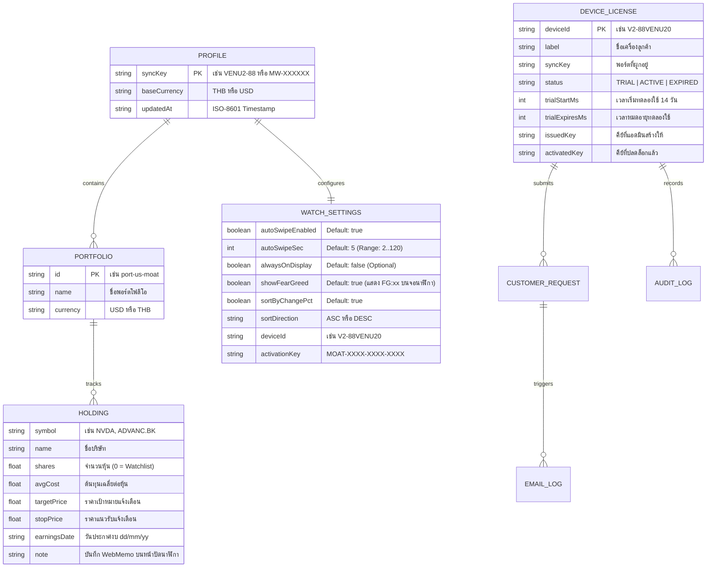

# MoatWatch — API Reference, Data Models & SDLC Guide (16 Automated Suites)

เอกสารฉบับนี้รวบรวมโครงสร้างฐานข้อมูล (`Entity-Relationship Diagram`), รายละเอียด REST API ทุก Endpoint พร้อมตัวอย่าง JSON Payload (รวมฟิลด์ `fearGreed` / `fg`), และขั้นตอนการทดสอบตามมาตรฐาน **SDLC (Software Development Life Cycle)** ทั้ง 16 ชุดทดสอบ

---

## 1. โครงสร้างข้อมูล (Data Model & ER Diagram)

ระบบจัดเก็บข้อมูลในรูปแบบ JSON ที่อ่านและสำรองข้อมูลได้ง่าย (`data/portfolios.json`, `data/licenses.json`, และไฟล์อีเมล `data/mail-outbox/*.eml`):



---

## 2. รายละเอียด REST API Endpoints

### 2.1 Watch & Web Companion Endpoints (`https://moat.readybyte.top`)

| Method | Endpoint | คำอธิบาย |
| :--- | :--- | :--- |
| `GET` | `/api/watch?key=VENU2-88&did=V2-XXXX&akey=...` | คืนค่า Compact JSON (`<4KB`) สำหรับแอปบนนาฬิกา Garmin ทั้ง 20 รุ่น พร้อมการตั้งค่า `cfg` (`asw`, `asec`, `aon`, `sfg`), ดัชนี `fg` (`FG:64G`), และสถานะไลเซนส์ `lic` |
| `GET` | `/api/portfolio?key=VENU2-88` | คืนค่าข้อมูลพอร์ตแบบเต็มพร้อมอ็อบเจกต์ `fearGreed` สำหรับหน้าเว็บ Companion และ Garmin Watch Simulator |
| `PUT` / `POST` | `/api/portfolio` | บันทึกการแก้ไขพอร์ตหุ้น, WebMemo, สกุลเงินหลัก และการตั้งค่า `watchSettings` (`autoSwipeEnabled`, `autoSwipeSec`, `alwaysOnDisplay`, `showFearGreed`, `sortByChangePct`, `sortDirection`) |
| `GET` | `/api/devices/supported` | คืนค่ารายชื่อนาฬิกา Garmin ทั้ง 20 รุ่นที่รองรับพร้อมความละเอียดหน้าจอ (`260×260` ถึง `454×454`) |
| `POST` | `/api/device/activate` | ตรวจสอบและปลดล็อก `deviceId` ด้วยรหัส `activationKey` (`MOAT-XXXX-XXXX-XXXX`) |
| `POST` | `/api/license/request` | ส่งคำขอ **Request Trial Key Extend** (`TRIAL_EXTEND`) หรือ **Purchase Request Form** (`PURCHASE_LICENSE`) พร้อมแจ้งเตือนไปที่ **`e24qdy2@gmail.com`** |
| `GET` | `/api/device/status?key=VENU2-88&did=V2-XXXX` | ตรวจสอบสถานะ Trial 14 วัน และสถานะการเปิดใช้งานของเครื่อง |
| `GET` | `/api/quote?symbol=NVDA` | ดึงราคาตลาดและอินดิเคเตอร์ของหุ้นรายตัวแบบเรียลไทม์ |
| `GET` | `/privacy` | หน้าประกาศนโยบายความเป็นส่วนตัว (Privacy Policy) สำหรับ Garmin Connect IQ Store |

#### ตัวอย่าง Compact JSON จาก `GET /api/watch?key=VENU2-88&did=V2-88VENU20`
```json
{
  "k": "VENU2-88",
  "bc": "THB",
  "fx": 33.58,
  "ts": 1792505891,
  "cfg": {
    "asw": 1,
    "asec": 5,
    "aon": 0,
    "srt": 1,
    "sdir": "ASC",
    "sfg": 1
  },
  "fg": {
    "v": 64,
    "c": "G",
    "r": "Greed",
    "st": "FG:64G",
    "cl": "#10B981"
  },
  "lic": {
    "did": "V2-88VENU20",
    "st": "TRIAL",
    "days": 14,
    "exp": 0,
    "own": "saharat.bun@icloud.com"
  },
  "tot": {
    "val": 1482910,
    "dp": 18420,
    "dPct": 1.25,
    "tp": 312450,
    "tPct": 26.69
  },
  "p": [
    {
      "id": "us-moat",
      "n": "US Wide Moat",
      "val": 920400,
      "dp": 14200,
      "dPct": 1.57,
      "tp": 248900,
      "tPct": 37.06,
      "al": 1,
      "s": [
        {
          "s": "NVDA",
          "sym": "NVDA",
          "cur": "USD",
          "p": 138.6,
          "px": 138.6,
          "c": 2.82,
          "pct": 2.82,
          "sh": 45,
          "avg": 92.5,
          "pPct": 49.84,
          "tgt": 135,
          "alrt": "TARGET_HIT",
          "ed": "e-28/05/26",
          "note": "AI GPU moat leader; hold core position",
          "spk": [128.4, 130.1, 133.5, 135.2, 138.6],
          "sma": 132.4,
          "smaP": 4.7,
          "rsi": 61.2,
          "lo": 135.1,
          "hi": 139.4,
          "ub": 140.2,
          "lb": 124.6
        }
      ]
    }
  ]
}
```

---

### 2.2 Admin Licensing Portal Endpoints (`https://admin-moat.readybyte.top`)

ทุก Endpoint ภายใต้ `/api/admin/*` บังคับตรวจสอบสิทธิ์ผู้ดูแลระบบ (`saharat.bun@icloud.com`):

| Method | Endpoint | คำอธิบาย |
| :--- | :--- | :--- |
| `GET` | `/api/admin/session` | ตรวจสอบสถานะการล็อกอินของแอดมิน (`saharat.bun@icloud.com`) และอีเมลแจ้งเตือน (`e24qdy2@gmail.com`) |
| `POST` | `/api/admin/auth/login` | ล็อกอินเข้าสู่ระบบผู้ดูแลด้วยรหัสผ่านเพื่อรับ Session Token |
| `POST` | `/api/admin/auth/change-password` | เปลี่ยนรหัสผ่านผู้ดูแลระบบหลังล็อกอิน (บังคับยืนยัน `currentPassword`) |
| `GET` | `/api/admin/devices` | ดึงรายชื่อเครื่องนาฬิกา Garmin ทั้งหมด, คิวคำขอของลูกค้า (`customerRequests`), ประวัติการส่งอีเมล (`emailLogs`), สถิติสรุป และ Audit Logs |
| `POST` | `/api/admin/requests/resolve` | อนุมัติหรือปฏิเสธคำขอของลูกค้าในคลิกเดียว (`APPROVE_EXTEND_7D`, `APPROVE_EXTEND_14D`, `APPROVE_ACTIVATE`, `REJECT`) |
| `GET` / `POST` | `/api/admin/email/config` | อ่านหรือบันทึกการตั้งค่าเซิร์ฟเวอร์ SMTP สำหรับส่งอีเมลแจ้งเตือนไปยัง `e24qdy2@gmail.com` |
| `POST` | `/api/admin/email/test` | ทดสอบส่งอีเมลแจ้งเตือนไปยัง `e24qdy2@gmail.com` ทันที |
| `POST` | `/api/admin/devices/generate-key` | สร้างรหัส Activation Key (`MOAT-XXXX-XXXX-XXXX`) ผูกกับ `deviceId` |
| `POST` | `/api/admin/devices/update` | เปลี่ยนสถานะเครื่อง (`ACTIVATE`, `EXPIRE_TRIAL`, `EXTEND_TRIAL`, `RESET_TRIAL`, `DELETE`) |

---

## 3. กระบวนการพัฒนาและทดสอบตามมาตรฐาน SDLC (`tests/sdlc.test.js` — 16 Suites)

โปรเจกต์นี้มีชุดทดสอบอัตโนมัติแบบ End-to-End ในไฟล์ [`tests/sdlc.test.js`](../tests/sdlc.test.js) ซึ่งตรวจสอบครบ **16 แกนหลัก (100% Pass)**:
1. **Subdomain Routing + VA C-01 + Security Headers:** ทดสอบ `Host: admin-moat.readybyte.top`, ตรวจสอบว่าไม่มี Password Hint รั่วใน View-Source และตรวจสอบ Security Headers
2. **VA C-02 & C-03 Protection:** ทดสอบการบล็อก Cloudflare Header Spoofing (`401`) และปิดกั้น Legacy OTP Backdoor (`403`)
3. **Web -> Watch Auto-Swipe & Always-On Sync:** ทดสอบการบันทึกค่า `autoSwipeEnabled`, `autoSwipeSec` (`5s` และ `9s`) และ `alwaysOnDisplay`
4. **Admin Password Login & Change Password:** ทดสอบการล็อกอินด้วยรหัสผ่านแอดมิน, การเปลี่ยนรหัสผ่านพร้อมยืนยันรหัสเดิม และคุกกี้ `HttpOnly`
5. **14-Day Free Trial Auto-Registration & Expiration Lock:** ทดสอบการลงทะเบียน Trial 14 วันอัตโนมัติและการล็อกหน้าจอเมื่อครบกำหนด
6. **Per-Device Activation Key & VA H-02 Redaction:** ทดสอบรหัสปลดล็อกรายเครื่อง `MOAT-XXXX-XXXX-XXXX` และตรวจสอบว่าไม่มี `issuedKey` รั่วไหลใน Public API
7. **Customer Trial Extend & Purchase Request + Admin 1-Click Approval + Email Dispatch:** ทดสอบฟอร์มคำขอลูกค้า, การส่งเมลไปที่ `e24qdy2@gmail.com` และการกดอนุมัติใน 1 คลิก
8. **Garmin 2024–2026 Compatible Devices Matrix:** ทดสอบความพร้อมของนาฬิกา Garmin ทั้ง 20 รุ่นใน `manifest.xml` และ `/api/devices/supported`
9. **VA H-01 Brute-Force Login Lockout:** ทดสอบการล็อก IP (`HTTP 429`) เมื่อใส่รหัสผ่าน Admin ผิดครบ 5 ครั้ง
10. **Auto-Sort `% Change` Setting (`ASC` / `DESC`):** ทดสอบการเรียงลำดับหุ้นตาม `% Change` ทั้งจากติดลบไปบวกและจากบวกไปติดลบ
11. **Watch & Web Stock Metrics:** ทดสอบความถูกต้องของ `Current Price`, `Last % Change`, `SMA20 + SMA20 %`, `RSI14`, `e-dd/mm/yy Earnings Date`, และ `Day High/Low`
12. **Cloudflare Worker Serverless Bundle:** ทดสอบการทำงานของ `src/worker.js` ทั้ง `/api/portfolio`, `/api/watch`, และ Stateless Admin Auth
13. **Deep Module Interface & Mock Seam (`lib/moatEngine.js`):** ทดสอบการฉีด Mock `marketFetcher` เพื่อคำนวณพอร์ตแบบไม่ต้องพึ่งเครือข่ายภายนอก
14. **Parts 2 & 3 Deep Modules (`MoatWatchLayout.mc` + `public/watchSimulator.js`):** ทดสอบโมดูลคำนวณพิกัดหน้าจอนาฬิกาและตัวจำลองหน้าปัดบนเว็บ
15. **Multi-User Profile & Trial Isolation:** ทดสอบการแยกข้อมูลพอร์ตและสิทธิ์ Trial 14 วันระหว่างผู้ใช้หลายคนไม่ให้ปะปนกัน
16. **Daily US Market Fear & Greed Index (`FG:xxG` / `FG:xxEF`):** ทดสอบการจัดโซนสีทั้ง 5 ระดับ (`EF`, `F`, `N`, `G`, `EG`), การซิงก์ผ่าน `/api/portfolio` และ `/api/watch`, สวิตช์เปิด/ปิด `showFearGreed`, และการแสดงผลบน Garmin Watch Simulator

### คำสั่งรันทดสอบ SDLC
```powershell
npm test
```
